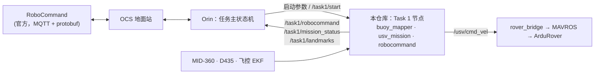

# RobotX 2026 Task 1（Safe Passage）· 纯 USV 方案

同济 MRL 的 Task 1 代码。UAV 没有通过验证，本仓库让 **USV 单独完成 Task 1 Core 级**：自己用激光雷达建浮标地图、用相机识别灯色，找到闪蓝入口并顺时针绕一圈，然后按“绿灯在左舷、红灯在右舷”穿过浮标，识别全部红绿浮标并上报，最后逆时针绕常蓝出口一圈。

本代码是 Orin 上**任务主状态机调用的一个任务模块**。它不连 RoboCommand，也不连地面站（OCS）：需要上报的内容以 ROS 话题发布，由主状态机订阅后转发给 OCS。

> **当前状态（2026-11-11）**：逻辑在开发电脑上完成。离线测试 153 项中 148 项通过、1 项跳过，另外 4 项是旧仿真节点的测试，需要 ROS 才能运行。闭环仿真（Delta 5 种比例尺、现场照片、Alpha 共 84 个场景）全部完成，并按 handbook 估分满分。**ROS 节点还没在 Orin 上运行过，也没接过真实雷达、相机和飞控。** 部署和分阶段上船验证见 [docs/task1/orin_deployment.md](docs/task1/orin_deployment.md)。

---

## 1. 在整个系统里的位置



- **主状态机给本代码的**：场地边界（四个角浮标）、场内非任务浮标的位置、测得的识色距离等启动参数，以及“开始”请求（见第 4 节）。
- **本代码给主状态机的**：准备好的上报内容（Heartbeat、SafePassageReport，JSON 格式，字段名与官方 proto 一致）、任务状态和事件、浮标地图（见第 3、5 节）。
- 飞控的解锁和模式切换不归本代码管：它**从不解锁、从不切模式**，只在飞控已解锁且处于 GUIDED 时输出速度。

---

## 2. 做了什么

### 2.1 任务流程（按 2026 Team Handbook 的 Task 1 Core）

| 顺序 | 状态（`mission_status.state`） | 做什么 |
|---|---|---|
| 0 | `WAIT_START` | 等 `/task1/start`，同时要求输入新鲜、飞控已解锁并处于 GUIDED |
| 1 | `SEARCH_ENTRY` / `LOOK` / `PLAN` / `TRANSIT` | 在边界内、浮标区外巡查，靠近浮标停船识色，直到找到**闪蓝入口**。这一阶段不进入浮标区 |
| 2 | `APPROACH_ENTRY` → `CIRCLE_ENTRY` | **顺时针**绕入口一圈。此后的通过才计分 |
| 3 | `PLAN` → `ALIGN` → `THREAD` | 挑一个红绿门（绿在左、红在右、净空 ≥ 1.2 m）对准后穿过，拿到“只左舷过绿”“只右舷过红”两项 |
| 4 | `PLAN` / `LOOK` / `TRANSIT` | 把剩下的浮标都识别出来，用于上报和全成奖励；到总时限的 75% 时停止 |
| 5 | `APPROACH_EXIT` → `CIRCLE_EXIT` | **逆时针**绕常蓝出口一圈 |
| 6 | `COMPLETE` | 结束，速度为零 |
| — | `HOLD` / `ABORT` | 输入超时时暂停（恢复后继续）；离开 GUIDED、超过总时限（默认 20 分钟）时中止 |

全程都会检查：任何一次通过，正横时该侧最近的浮标都不能是错侧的红灯或绿灯；未识别的浮标不会被带到正横；与浮标、平台或码头、边界保持净空。

### 2.2 主要算法

| 模块 | 内容 |
|---|---|
| 建图 `landmark_map.py`、`survey_core.py` | 雷达点云按帧聚类，按尺寸区分浮标与大物体。浮标做最近邻关联，确认后成为路标（最多 10 个，编号 `B1…B10`）；大物体（平台、码头、他船）进入 0.5 m 障碍栅格。边界外的目标、离角浮标或 `markers` 不到 1 m 的目标都不算 |
| 识色 `survey_core.classify_roi`、`LampClassifier` | 把路标投影到相机图像上，在灯的位置取一块区域，按 HSV 判断亮灯颜色；连续 2–4 s 的观测区分闪烁和常亮。只在 `color_range` 内判断 |
| 规划 `gap_planner.py` | 浮标、障碍点和边界墙点做 Delaunay 三角剖分，路线经过三角形边。每段航线用独立的“正横判定”检查侧向规则，留 5 cm 等距余量和 0.15 m 正横余量。找入口阶段使用“场外模式”，不进浮标区 |
| 任务 `mission_core.py` | 第 2.1 节的状态机，加上红绿门选择、识色观察点、找不到路线时的短航段绕行、死角检测，以及运动保护：每个控制周期预测 1 s，会造成错侧或带到未识别浮标的运动一律停下 |
| 控制 `track_control.py` | 直线跟踪（航向误差大时原地转向）、定半径绕圈、前方停船框 |
| 上报 `robocommand_core.py` | 生成 Heartbeat 和 SafePassageReport 的内容；路标通过船位换算成经纬度 |

---

## 3. 节点、话题与服务

用一个启动文件启动全部节点：`ros2 launch robotx_task1 task1_usv.launch.py ...`（参数见第 4.2 节）。它会同时启动 `usv_nav2` 包里的 `odom_tf`（飞控里程计转 `/usv/odom` 和 TF）和 `rover_bridge`（速度指令转 MAVROS 设定点，自带各种控制门限）。**不要同时启动 Nav2**：`/usv/cmd_vel` 只能有一个发布者。

### 3.1 `buoy_mapper`：建图与识色

| 方向 | 话题 / 服务 | 类型 | 说明 |
|---|---|---|---|
| 订阅 | `/usv/lidar/filtered` | `sensor_msgs/PointCloud2` | `livox_filter` 输出的点云 |
| 订阅 | `/usv/odom` | `nav_msgs/Odometry` | `odom → base_link`，按点云和图像的时间戳插值 |
| 订阅 | `/camera/color/image_raw`、`/camera/color/camera_info` | `Image`、`CameraInfo` | D435 彩色流。`color_range=0` 时不使用相机 |
| 订阅 | `/tf_static` | `tf2_msgs/TFMessage` | 雷达和相机的安装 TF；`map → odom`（由 `map_origin` 发布）用来换算边界 |
| 发布 | **`/task1/landmarks`** | `robotx_task1_interfaces/BuoyArray` | 浮标地图（odom 系），10 Hz |
| 发布 | `/task1/obstacles` | `PointCloud2`（odom 系） | 障碍栅格中心点加上 `markers` |
| 发布 | `/task1/mapper_status` | `std_msgs/String`（JSON） | 帧计数、路标数、障碍格数、被拒绝的路标数、相机是否就绪 |

### 3.2 `usv_mission`：任务状态机

| 方向 | 话题 / 服务 | 类型 | 说明 |
|---|---|---|---|
| 订阅 | `/task1/landmarks`、`/task1/obstacles` | 同上 | 超过 1 s 未更新即视为过期，进入 `HOLD` |
| 订阅 | `/usv/odom` | `Odometry` | 超过 0.5 s 视为过期 |
| 订阅 | `/scan` | `LaserScan` | `cloud_to_scan` 输出，用于前方停船框 |
| 订阅 | `/mavros/state` | `mavros_msgs/State` | 只读，用来判断是否已解锁、是否处于 GUIDED |
| 订阅 | `/tf_static` | | `map → odom`，用来换算边界 |
| 订阅（可选） | `/mavros/gpsstatus/gps1/raw` | `mavros_msgs/GPSRAW` | 仅当 `require_rtk_fixed:=true` 时使用 |
| **服务** | **`/task1/start`** | `std_srvs/Trigger` | 开始任务。返回成功不代表船已开动，见第 4.3 节 |
| 发布 | **`/task1/mission_status`** | `std_msgs/String`（JSON） | 每周期（10 Hz）一条，见第 5.2 节 |
| 发布 | `/usv/cmd_vel` | `geometry_msgs/Twist` | 只有 `enable_motion:=true` 时才创建这个发布者 |

### 3.3 `robocommand`：准备上报内容

| 方向 | 话题 | 类型 | 说明 |
|---|---|---|---|
| 订阅 | `/mavros/global_position/global` | `NavSatFix` | 船的经纬度 |
| 订阅 | `/usv/odom`、`/mavros/state` | | 航向、速度、姿态，以及解锁和模式状态 |
| 订阅 | `/task1/landmarks`、`/task1/mission_status` | | 浮标地图和任务状态 |
| 发布 | **`/task1/robocommand`** | `std_msgs/String`（JSON） | Heartbeat（2 Hz）和 SafePassageReport（地图变化时发送，每 10 s 补发一次），格式见第 5.3 节 |
| 可选输出 | UDP → `ocs_host:ocs_port` | JSON | 只在 `ocs_host` 非空时直接发给 OCS（`scripts/ocs_relay.py` 接收）。**由主状态机转发时，把 `ocs_host` 留空** |

如果飞控位置超过 2 s 没有更新，这个节点就不发 Heartbeat，以免把旧位置当成当前位置上报。

---

## 4. 主状态机要提供什么

### 4.1 启动前必须准备好的环境

| 项目 | 来源 | 本代码怎么用 |
|---|---|---|
| MAVROS 连接飞控，EKF 使用双天线 GPS 航向 | 平台 | 定位、航向、解锁和模式状态 |
| `map_origin` 在 `/tf_static` 发布 `map → odom` | `usv_sim` 包 | 把 map 系的边界和 `markers` 换算到 odom 系。**没有它，船不会开动**（`input_problem` 会提示 `course boundary not georeferenced`） |
| 雷达和相机的安装 TF，MID-360 驱动、`livox_filter`、`cloud_to_scan`、D435 彩色流 | 平台 | 建图、识色、停船框 |
| Nav2 **不运行** | 主状态机 | `/usv/cmd_vel` 有两个发布者时，任务节点拒绝输出速度 |

### 4.2 启动参数：场地边界等先验信息

这些参数在启动时传入，**运行中不能修改**，换场地就重新启动。坐标都在 **map 系**：原点是 `.env.boat` 里的 `USV_MAP_LAT/LON`，x 向东、y 向北，单位米。

| 参数 | 格式 | 例子 | 说明 |
|---|---|---|---|
| **`boundary`** | JSON `[[x,y], …]` | `'[[0,0],[25,0],[25,30],[0,30]]'` | **四个字母角浮标**，按场地一圈的顺序给出。用途：建图只接受边界内的目标，角浮标本身不占路标名额；规划把边界当墙，离边界线保持 0.8 m 以上；找入口时沿边界内 2 m 巡查。不填也能运行，但船不知道不能出界，也没有巡查路线 |
| `markers` | JSON `[[x,y], …]` | `'[[2.2,1.2],[11.2,1.7]]'` | 场内**不属于 Task 1 的浮标**，比如 Alpha 南侧两个无灯起点门浮标。这些浮标不当路标，只当障碍物绕开 |
| **`color_range`** | 米 | `4.5` | 实测可靠识色距离（survey 第 1 步测得）。**0 表示关闭识色**：所有浮标都保持“未识别”，船也就不会穿过任何浮标 |
| `look_range` | 米 | | 停船识色的距离，默认 `color_range - 0.5` |
| `min_z`、`max_z`、`lamp_offset` | 米 | | 浮标点云的高度窗口（相对 `base_link`），以及灯相对点云顶部的高度 |
| `cruise_speed`、`thread_speed`、`max_yaw_rate` | m/s、rad/s | `0.2` | 不能超过 `rover_bridge` 的上限 |
| `enable_control` | bool | `false` | `rover_bridge` 是否真的把设定点发给飞控 |
| `enable_motion` | bool | `false` | 任务节点是否发布 `/usv/cmd_vel`。为 false 时只是预览 |
| `require_rtk_fixed` | bool | `false` | 为 true 时，只有 RTK 固定解才允许穿缝 |
| `vehicle_id` | 字符串 | `USV1` | 写进上报 JSON |
| `ocs_host` / `ocs_port` | | `''` | **主状态机负责转发时留空** |
| `params_file` | 路径 | | `scripts/prepare_hardware.py` 生成的 `nav2.yaml`，`odom_tf` 和 `rover_bridge` 从中读取参数 |

把角浮标的经纬度换算成 map 坐标（主状态机里可以直接调用同一个函数）：

```python
from usv_sim.map_origin import local_xy
x, y = local_xy(lat, lon, USV_MAP_LAT, USV_MAP_LON)   # 东、北，米
```

启动示例（数值只是示例，以实测为准）：

```bash
ros2 launch robotx_task1 task1_usv.launch.py params_file:="$USV_WORKSPACE/runs/hardware_config/nav2.yaml" \
  color_range:=4.5 min_z:=-0.6 max_z:=1.5 boundary:='[[0,0],[25,0],[25,30],[0,30]]' \
  markers:='[[2.2,1.2],[11.2,1.7]]' enable_control:=true enable_motion:=true ocs_host:=''
```

### 4.3 开始任务

船开动需要同时满足下面全部条件，缺一个就输出零速度：

1. 启动时 `enable_motion:=true`，并且 `enable_control:=true`；
2. 已经调用 `/task1/start`：
   ```bash
   ros2 service call /task1/start std_srvs/srv/Trigger
   ```
3. 输入都是新鲜的（`mission_status.inputs_ok == true`），且边界已经换算到 odom 系；
4. 飞控已解锁并处于 **GUIDED**。这两步由主状态机或操作员完成，本代码不会去做。

建议主状态机的顺序是：收到 RoboCommand 的 RunStart → 解锁、切 GUIDED → 调用 `/task1/start` → 订阅 `/task1/mission_status`，看到 `state` 离开 `WAIT_START` 就说明已经开始。

### 4.4 结束与中止

| 情况 | 本代码的表现 | 主状态机该做什么 |
|---|---|---|
| 正常完成 | `state` 变为 `COMPLETE`，events 里有 `complete`，速度为零 | 接管船，进入下一个任务 |
| 超过总时限（默认 1200 s） | `ABORT`，`events` 中 `reason` 为 `total time limit reached` | 同上 |
| 主状态机或操作员把飞控切出 GUIDED | 立即 `ABORT`，速度为零；**切回 GUIDED 也不会自己恢复** | 需要重新运行时，重启 Task 1 的启动文件 |
| 输入中断（雷达、相机、里程计、飞控状态） | `HOLD`，速度为零；输入恢复后自动继续 | 看 `input_problem` 找原因 |

> 目前**没有“停止”服务**。主状态机要提前结束 Task 1，可以把飞控切出 GUIDED（任务立即进入 `ABORT`），或者停止这个启动文件（退出前会发一次零速度）。如果需要 `/task1/stop` 服务，或者需要在运行中更新边界，可以再加。

---

## 5. 主状态机要订阅什么

### 5.1 得分点与对应的信息

| handbook Core 得分项 | 分值 | 怎么得分 | 主状态机要做的 |
|---|---|---|---|
| Heartbeat | 25 | 2 Hz 心跳 | 转发 `/task1/robocommand` 中 `kind=heartbeat` 的消息。如果主状态机自己已经在发心跳，就只用其中的 `current_task` |
| 上报入口、出口位置 | 10 + 10 | SafePassageReport 的 `entry_position`、`exit_position` | 转发 `kind=safe_passage` 的消息 |
| 上报绿灯、红灯位置 | 各 10 分/个，最多 4 个 | SafePassageReport 的 `buoys` | 同上 |
| 顺时针绕入口、逆时针绕出口 | 25 + 25 | 由船的行为完成，裁判观察 | 不需要上报，可以从事件 `circle_entry_done` / `circle_exit_done` 得知完成情况 |
| 只左舷过绿、只右舷过红 | 25 + 25 | 由船的行为完成 | 不需要上报，可以从事件 `credit` 得知 |
| 全成奖励 | 100 | 以上全部完成 | — |

### 5.2 `/task1/mission_status`（`std_msgs/String`，JSON，10 Hz）

```json
{"state": "THREAD", "detail": "threading gap B4 | B2, offset +0.01 m", "v": 0.25, "w": -0.02,
 "inputs_ok": true, "input_problem": "", "blocked": false, "rtk_ok": true, "motion_enabled": true,
 "passed": [], "assumed_off": [], "events": [{"type": "credit", "item": "red_to_starboard", "id": "B2"}]}
```

- `state`：第 2.1 节的状态名。主状态机通常只关心 `WAIT_START`、`COMPLETE`、`ABORT`、`HOLD`。
- `events`：**只出现在发生的那一个周期里**，需要的话主状态机自己记下来。常用的事件：

| 事件 `type` | 字段 | 含义 |
|---|---|---|
| `started` | | 任务真正开始 |
| `entry_found` / `exit_found` | `id` | 地图中出现了闪蓝 / 常蓝浮标 |
| `circle_entry_done` / `circle_exit_done` | `id` | 绕圈完成 |
| `credit` | `item`（`green_to_port` / `red_to_starboard`）、`id` | 船按自己的地图判断拿到了一个侧向得分项 |
| `wrong_side` | `id`、`side` | 船自己判断出现了错侧，正常情况下不应出现 |
| `complete` | | 任务完成 |
| `abort` | `reason` | 任务中止 |
| `hold` / `resumed` | | 输入中断 / 恢复 |
| `no_route`、`rule_guard`、`blocked` | | 暂时没有合法路线、运动保护介入、前方有障碍；用于诊断 |

### 5.3 `/task1/robocommand`（`std_msgs/String`，JSON）

每条消息格式为 `{"vehicle_id": ..., "kind": "heartbeat" | "safe_passage", "body": {...}}`。`body` 的字段名和枚举值与官方 `robonation/robocommand` 仓库 `RobotX_2026/proto` 中的 `Heartbeat`、`SafePassageReport` 一致，可以直接用 `google.protobuf.json_format.ParseDict` 填进 protobuf（`scripts/ocs_relay.py` 的 `build_report` 就是这么做的，可以参考）。

```json
{"vehicle_id": "USV1", "kind": "heartbeat", "body": {
  "state": "STATE_AUTO", "position": {"latitude": 1.2809652, "longitude": 103.8548424},
  "spd_mps": 0.25, "heading_deg": 87.5, "roll_deg": 0.3, "pitch_deg": -0.8, "altitude_hae_m": 5.1,
  "current_task": "TASK_SAFE_PASSAGE", "vehicle_type": "TYPE_USV"}}
```

```json
{"vehicle_id": "USV1", "kind": "safe_passage", "body": {
  "buoys": [{"position": {"latitude": 1.2810011, "longitude": 103.8549012}, "state": "BEACON_STATE_FLASHING_RED"},
            {"position": {"latitude": 1.2810105, "longitude": 103.8549277}, "state": "BEACON_STATE_FLASHING_GREEN"}],
  "entry_position": {"latitude": 1.2810532, "longitude": 103.8549120},
  "exit_position": {"latitude": 1.2809901, "longitude": 103.8550010}}}
```

- 未识别的浮标不上报。上报的状态可以是灭、闪红、闪绿、闪蓝、常蓝。
- `current_task`：任务进行中为 `TASK_SAFE_PASSAGE`，结束（`COMPLETE`/`ABORT`）或尚未开始时为 `TASK_NONE`。
- **两处需要向裁判确认**（proto 没有定义）：`heading_deg` 按真北起顺时针计；未解锁时 `state` 报 `STATE_KILLED`。
- RoboCommand 限制每个系统每秒最多 5 条消息。本节点心跳 2 Hz，SafePassageReport 间隔至少 1 s。

### 5.4 `/task1/landmarks`（`BuoyArray`）

想在主状态机或地面站显示浮标地图时可以订阅。`Buoy.state` 的取值：`0` 灭、`1` 闪红、`2` 闪绿、`3` 闪蓝（入口）、`4` 常蓝（出口）、`5` 未识别。坐标在 **odom 系**，`id` 为 `B1…B10`，在一次运行中保持不变。

---

## 6. 目录结构

```
src/robotx_task1/                 Task 1 包（ament_python）
  robotx_task1/
    buoy_mapper.py  usv_mission.py  robocommand.py      ← 本方案的三个 ROS 节点
    landmark_map.py survey_core.py  gap_planner.py      ← 纯算法，不依赖 ROS，可以离线测试
    mission_core.py track_control.py robocommand_core.py core.py（正横判定）
    survey_bag.py survey_check.py                       ← 录包分析：测识色距离、检查数据
    mission.py observer.py traffic*.py judge.py …       ← 早期“UAV 观测 + 仿真”方案，保留未改
  launch/task1_usv.launch.py
  test/        离线测试（unittest，不需要 ROS）    test_ros/   ROS 节点测试（在 Orin 上运行）
src/robotx_task1_interfaces/      Buoy、BuoyArray 等消息
src/usv_nav2/                     odom_tf、rover_bridge（平台层）和 Nav2 参数
src/usv_sim/                      map_origin、livox_filter 等
src/robotx_task1_nav/             早期仿真方案，保留未改
scripts/
  build_hardware.sh               Orin 上构建
  ocs_relay.py                    参考实现：OCS 端 UDP JSON → RoboCommand（MQTT + protobuf）
  visualize_task1_field.py        场地闭环回放（--field photo|delta|alpha，--video 输出 MP4）
  task1_video.py                  回放视频渲染
docs/task1/                       方案、部署、上船步骤、记录
```

---

## 7. 构建、测试与仿真回放

在 Orin 上（ROS 2 Humble）构建：

```bash
bash scripts/build_hardware.sh && source scripts/hardware_env.sh
```

离线测试（任何装了 numpy 和 scipy 的 Python 3.10+ 都能跑）：

```bash
cd src/robotx_task1/test && PYTHONPATH=.. python3 -m unittest discover -s . -p "test_*.py"
```

ROS 节点测试（Orin 上，用单独的 `ROS_DOMAIN_ID`）：

```bash
python3 -m unittest discover -s src/robotx_task1/test_ros -p "test_usv_nodes.py" -v
```

场地闭环回放，输出交互页面和 MP4 到 `runs/task1_alpha_viz/`：

```bash
python3 scripts/visualize_task1_field.py --field alpha --video
```

视频需要 matplotlib 和带 libx264 的 ffmpeg（`pip install imageio-ffmpeg` 即可）。`runs/` 不进 git。

---

## 8. 已知限制与待确认

- 仿真用的是简化船模（没有风、流和侧滑）和理想传感器（在设定距离内一定能看到），验证的是决策逻辑，不代表控制精度。
- 窄缝里船体离浮标最近约 0.15–0.2 m，对控制精度要求最高，上船时要先单独验证一个红绿门。
- 识色阈值、曝光、相机时间戳、雷达聚类的高度窗口，都还没见过真实数据。
- 需要向裁判确认的规则：绕圈时圈外浮标经过正横是否算通过；`heading_deg` 的定义；未解锁时报告什么状态。
- Alpha 截图面板写的是“入口 buoy-10、出口 buoy-1”，现场看到的是 1 号闪蓝。船靠闪烁和常亮来判断入口和出口，不依赖编号；两种情况都仿真通过了。
- 没有 `/task1/stop` 服务，边界也不能在运行中更新（见第 4.4 节）。

## 9. 文档

| 文档 | 内容 |
|---|---|
| [docs/task1/orin_deployment.md](docs/task1/orin_deployment.md) | **Orin 部署与分阶段上船验证（从这里开始）** |
| [docs/task1/usv_only_plan.md](docs/task1/usv_only_plan.md) | 方案设计 |
| [docs/task1/usv_only_runbook.md](docs/task1/usv_only_runbook.md) | 代码结构、修复记录、场地回放结果 |
| [docs/task1/usv_only_survey.md](docs/task1/usv_only_survey.md) | 识色距离测量（survey） |
| [docs/hardware_deployment.md](docs/hardware_deployment.md) | Orin 基础环境：ROS 2、MAVROS、MID-360、地图原点 |
| [docs/nav_validation_readme.md](docs/nav_validation_readme.md) | 原仓库说明：VRX + ArduRover SITL + Nav2 导航验证 |
| [AGENTS.md](AGENTS.md) | 开发约定 |
