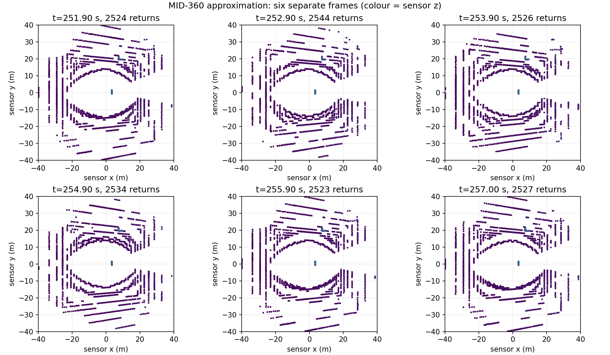
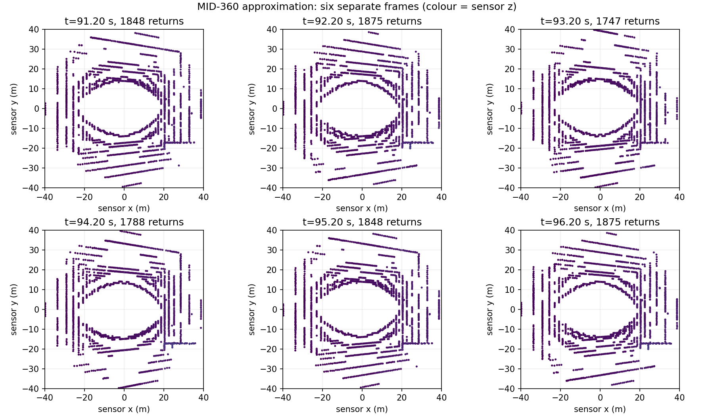
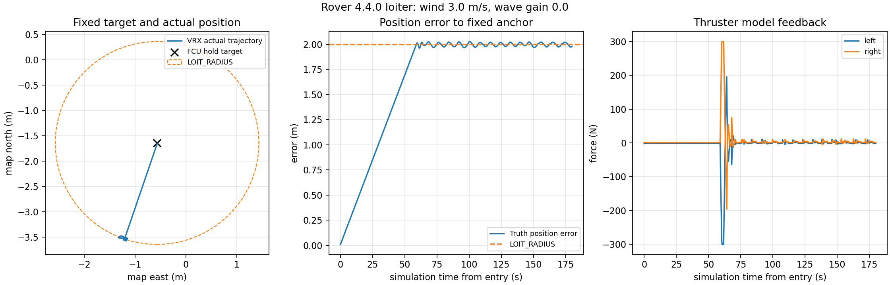
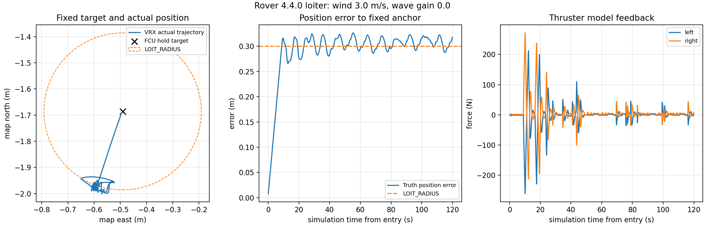

# 2026-11-04：MID-360 仿真与原生 LOITER 实验

固定 ArduRover V4.4.0 `d0356316eb0fa34ed1c9f39f7b059b9ae7ba4664`。实现和复现命令见 [运行说明](../loiter_mid360.md)，原始路径、结果 JSON、文件 SHA256 见 [证据索引](20261104_loiter_mid360.json)。运行目录名沿用服务器时间；本文日期按用户 Asia/Shanghai 时区记录。

## 已完成的实际测试

| 实验 | 配置与观测时长 | 实测结果 |
|---|---|---|
| 原生 LOITER 基线 | 原 16 线雷达；风 3 m/s、无浪；LOIT_RADIUS=2 m；180 s | RMS 1.765 m，P95 2.019 m，最大 2.026 m；目标固定；无接触；恢复 GUIDED 成功 |
| MID-360 接口与预处理 | 平静水面；到点后重新观测 12 s | 原始点云/最终扫描各 120 帧，均 10 Hz；最大扫描间隔 0.1 s；源时间戳一致；无观测角度保留 NaN |
| MID-360 单目标导航 | `(5, 0, 0)`，1 次 | action 成功，真值位置误差 0.359 m、航向误差 0.038 rad；最小静态几何净空 1.566 m；无接触记录 |
| MID-360＋小半径 LOITER | 风 3 m/s、无浪；LOIT_RADIUS=0.3 m；120 s | RMS 0.297 m，P95 0.322 m，最大 0.326 m，末端 0.318 m；目标固定；无接触；恢复 GUIDED 成功 |
| 风中纠偏时 MID-360 链路 | 与上一行同期观测约 60 s | 原始点云/过滤/扫描各 598 帧，10 Hz；最大间隔 0.1 s；已捕获对应原始帧的 597 张扫描时间戳完全匹配，其余 1 帧先于检查器原始订阅起点 |
| 2026 Task1 港口预览 | 原有港口和 2026 浮标；控制关闭；15 s | 原始点云/过滤/扫描各 150 帧，10 Hz；最大扫描间隔 0.1 s；150 张扫描源时间戳匹配；未运行比赛任务 |

每个 LOITER 配置只有一次冷启动，不是重复三次的稳定性验收。两组雷达配置和观测时长不同，不将其当作仅改变保持半径的严格对照。10 秒零速度指令后进入 LOITER，也不代表风中船体已经物理静止。

LOITER 目标取自飞控 `POSITION_TARGET_GLOBAL_INT`，两轮目标变化均为 0。Gazebo 真值仅用于误差评估；Nav2 定位、预处理运动补偿和飞控控制均沿用 MAVROS EKF。单目标结束后仍是现有零速度行为，10 秒漂移 0.190 m；该单目标测试没有自动切入 LOITER。

MID-360 每帧采样 20,000 条模拟射线，到点后的基础场景实际返回 2,519～2,594 个点，风中保持场景为 1,880～2,015 个点，港口预览为 1,736～1,876 个点；没有返回的射线不补成点。配置一帧 5 个测量片段，基础场景有效返回出现于其中 3 个片段，点时间跨度约 40 ms；本次港口预览有效返回仅出现在 1 个片段。CSV 各片段扫过的俯仰角不同，朝天空的射线没有返回。原始帧最大源年龄约 88 ms，不能将有效点数误报成固定 20,000 点/帧。

接口检查只确认输出速率、格式、时间及扫描中存在有限距离值，不代表已逐个识别港口障碍。当前高安装位与约 7° 下视场形成明显近场盲区，港口扫描绝大部分角度仍是 NaN；必须补做低障碍可见性、安装位置以及动态清除专项测试。仿真还会渲染理想水面回波，不能当作真实水面探测效果。

## 控制限制

原生 LOITER 使用自己的控制参数，不能假定受 Nav2 速度上限约束。本轮飞控 `WP_SPEED=2 m/s`、`LOIT_TYPE=0`、`LOIT_SPEED_GAIN=0.5`。默认半径实验观测到瞬时 ±300 N 模型推力及 0.501 rad/s 偏航速度；小半径实验峰值推力 271.2 N、平面速度 0.093 m/s、偏航速度 0.352 rad/s。它们是模型反馈/真值，不是实船测量。

小半径实验通过事先给定的 0.5 m 最大误差判据，但约 60.6% 样本仍略超过 0.3 m 半径：风中需要在半径外产生纠偏速度，这个半径不能直接作为硬性的占用边界。后续 Task1 模式管理需要单独限制纠偏速度、评估全船扫掠范围和可能的倒车，并监测定位与障碍。当前运动许可不能直接阻断原生 LOITER。

## 未验证范围与失败保留

- 未启用 Task1 自动 LOITER 等待，未完成 MID-360 配置下的整场 Task1 避障回归；现有 Task1 默认仍用原雷达和 GUIDED 零速度等待。
- 未做本轮风浪组合、GNSS 降级、手动接管、长期封路或移动障碍突然转向的定点保持试验。
- 未测真实 MID-360、真实电调/推进器或 1.2 m × 0.7 m 实船；仿真没有标定水面光学、多径、雨雾和浪花。
- 保留时钟传输失败、错误帧计数判据、首次插件路径错误和同步 TF 导致丢帧的运行目录。修复和回归依据见运行说明。旧失败不计为通过。
- 停止 Gazebo 时仍可见 `WaveVisual` / `Task1Scene` 插件析构段错误；2026-11-02 的原雷达运行目录已有同类日志。此次受管进程均已退出，退出阶段仍未通过正常析构检查；不要把运行期链路通过扩展为此项通过。
- 纯逻辑/消息替身检查：24 项导航、18 项仿真辅助、2 项会话所有权检查通过；`git diff --check` 通过。这些与表中的实际 ROS / SITL / VRX 测量分别统计。

原始资料包括 `/home/zjy/usv_nav/runs/20261104_021702_loiter_wind_verified_counter`、`/home/zjy/usv_nav/runs/20261104_022706_mid360_tf_queue`、`/home/zjy/usv_nav/runs/20261104_023249_mid360_loiter_wind_small`、`/home/zjy/usv_nav/runs/20261104_023824_mid360_harbor_preview`。基础 MID-360 和港口预览目录内均有 `overview.mp4`、截图及原始点云快照；视频是场景预览，不是完整航行录像。大型文件没有加入 Git。
