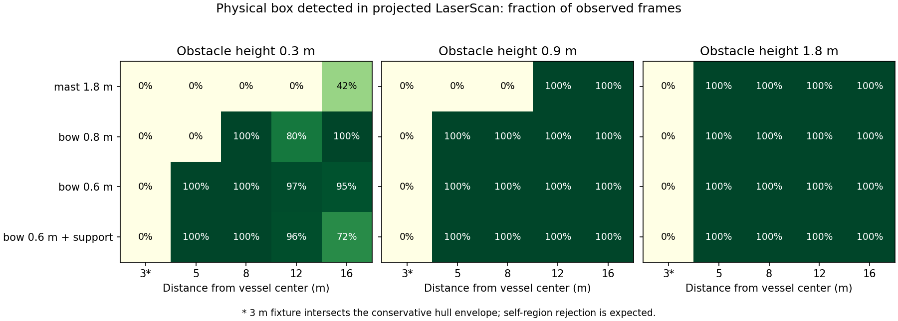
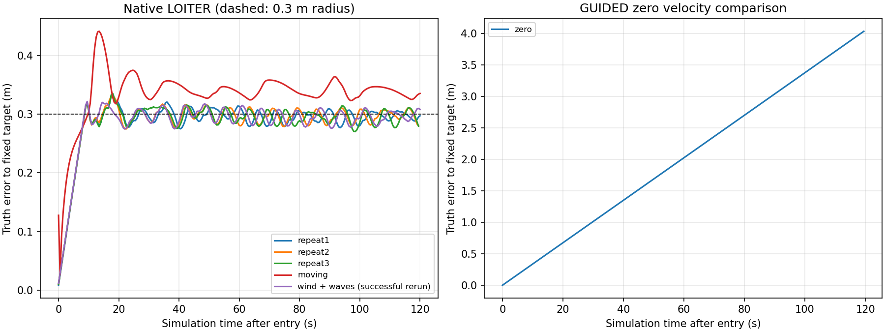
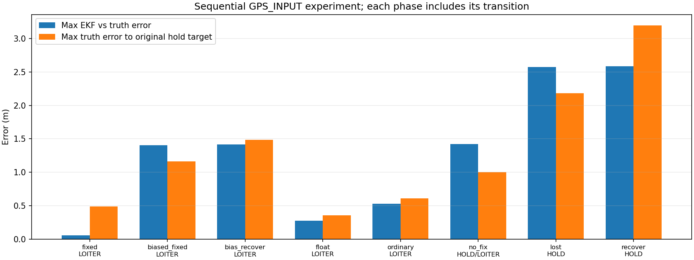
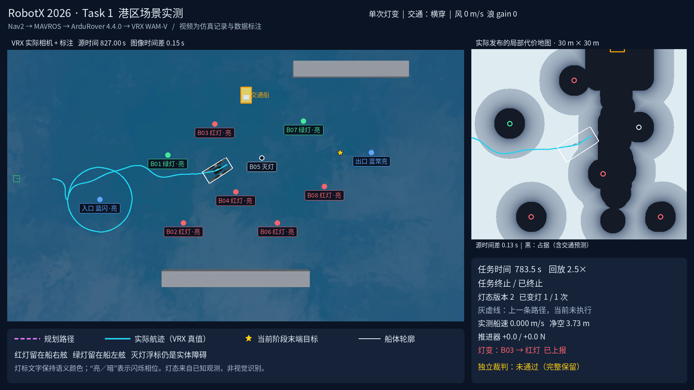

# MID-360 与原生 LOITER 补充仿真验证

日期：2026-11-04。本轮实验已结束，仿真进程全部停止。原生保持、交接及静态 Task1 通过；动态 Task1 因占据清除未完成，直接 Gazebo reset 未自动恢复，GNSS 偏置仍有保护缺口。机器可读证据见 [运行清单](simulation_verification/runs.json) 与 [结果及来源哈希](simulation_verification/evidence.json)。所有原始目录位于 `/home/zjy/usv_nav/runs/`，失败记录也保留。

## 配置与判据

- 固定 ArduRover **V4.4.0 / `d0356316eb0fa34ed1c9f39f7b059b9ae7ba4664`**、递归子模块和 Garden 插件提交；未升级飞控。每次冷启动记录源码快照、二进制/补丁哈希和有效参数。
- ROS 2 Humble、Gazebo Garden 7.9、VRX WAM-V；导航和点云运动补偿均使用飞控 EKF 经 MAVROS 输出的定位。Gazebo 真值只进入传感器生成与独立评价。
- 对照安装：mast `[0.7,-0.3,1.8]`、bow `[2,0,0.8]`、low_bow `[2,0,0.6]`，单位 m，相对 `base_link`。移动雷达外观和碰撞体，调整支架；船体惯性未重新辨识。这些是仿真安装候选，不是实船安装结论。
- MID-360：10 Hz、每帧 5 个物理时间片，原始逐点时间保留；无返回保持未知。继续使用 `pointcloud_to_laserscan`，未把 NaN 转成伪自由射线。
- Task1 使用规则约束规划器与 DWB；继承碰撞修复后的参数：全局 footprint padding **1.0 m**、局部 **0.5 m**、膨胀半径 **4.5 m**。没有为通过新雷达实验缩小船体或安全余量。
- 原生保持配置：`LOIT_RADIUS=0.3 m`、`LOIT_TYPE=0`、`LOIT_SPEED_GAIN=0.5`、`WP_SPEED=0.3 m/s`、`ATC_STR_RAT_MAX=23 deg/s`。原生纠偏仍由飞控决定；0.3 m 参数不是最大误差保证。
- 单独保持试验的最大真值误差预算为 **0.8 m**；Task1 终点仍按 **0.5 m / 0.25 rad** 判断，两者不可混用。零速度对照只比较漂移，不作为定点精度通过项。

## 实体可见性与清除

使用 Gazebo 中真实的 1 m × 1 m 箱体，改变高度、距离和方位；根据当时飞控 TF 将实体位置与 raw / marking / scan 的回波关联。每个距离样本观察 4 s。只在相互独立、disarm 的箱体样本之间清空 costmap；移走实验和导航过程中不调用强制清图。

| 结果 | 解释 |
|---|---|
| 原 1.8 m 安装对 0.3 m 障碍在 3–12 m 没有投影检测 | 原高位安装确实存在低矮物近场可见性问题 |
| low_bow 在 5 m、8 m 对 0.3 m 箱体均为 100% 扫描帧检测 | 降低安装位置改善本模型中的低障碍可见性 |
| 最终过滤下 12 m 约 96%、16 m 约 72% | 远处稀疏低物体仍可能间歇漏检，不能声称全距离可靠探测 |
| 5 m 处每 45° 一点，0.3/0.9 m 两种高度，共 16 组合均为 100% | 验证了这些有限方位样本；不等于任意实物/倾角均无盲区 |
| 3 m 箱体近侧为 2.5 m，进入保守船体包络 | 被船体过滤拒绝是预期行为，此点不能单独用来量化雷达光学盲区 |
| 障碍移开且后方有真实背景回波：81→0 占据格 | 真实射线可以清除原位置 |
| 障碍移开而后方是无回波水域：81→81 占据格 | 清除未通过；保留未知/残留，未伪造自由空间 |

表中的“占据格”按 OccupancyGrid ≥99 统计，含致命格及内切膨胀格；历史结果 JSON 的 `lethal_cells` 字段命名不能理解为只包含致命中心格。

第一次 MID 港区全流程在入口绕标途中受孤立占据格阻塞，保存证据后主动取消，未记为完成。回放表明孤立回波在船未移动时已经出现，之后开阔水面缺少可清除它们的背景返回。加入回波支持过滤：同帧 0.3 m 邻域至少 3 点，或连续前两帧均有邻近支持；使用飞控 odom 坐标，不查询真值。被拒绝的回波也不能用于清除。

诊断回放中，20 s 后、15 m 内与实体几何不关联的候选点由 1139 降至 52，实体关联点由 3507 降至 3489。该几何分类只用于离线诊断；不构成真实水面反射模型。稀疏持久物体可能增加约 0.2 s 确认延迟，16 m 低箱体检测比例由约 95% 降至 72%，必须保留这一取舍。

## 原生保持与零速度对照

全部保持实验使用最终 low_bow MID 配置，独立冷启动。目标来自飞控 `POSITION_TARGET_GLOBAL_INT`；120 s 测量中不重复捕获当前位置来缩小误差。保持测试器禁止与 Task1 任务并行控制。

| 实验 | RMS 真值误差 m | 最大真值误差 m | 末端误差 m | 结论 |
|---|---:|---:|---:|---|
| 3 m/s 风，重复 1 | 0.291 | 0.335 | 0.297 | 通过 0.8 m 预算，固定目标不变 |
| 3 m/s 风，重复 2 | 0.291 | 0.330 | 0.280 | 通过，固定目标不变 |
| 3 m/s 风，重复 3 | 0.290 | 0.336 | 0.277 | 通过，固定目标不变 |
| 同风，GUIDED 持续零速度 | 2.338 | 4.050 | 4.050 | 对照测量完成；不能保持位置 |
| 运动中进入 LOITER | 0.337 | 0.442 | 0.335 | 通过 0.8 m 预算，固定目标不变 |
| 风 3 m/s + wave gain 0.08 | 0.290 | 0.322 | 0.308 | 复测通过，固定目标不变 |

前三次均无碰撞、无推力饱和，最大角速度约 0.373 rad/s。约 40% 的采样位于 0.3 m 半径外，进一步说明半径是原生控制参数，不能直接当成误差上界。风是当前 VRX 风力模型的 3 m/s 输入；浪使用模型 gain，不将其标成实测浪高。

风浪组合中，船体升沉峰峰值 0.0577 m，横摇/纵摇峰峰值 0.476°/0.507°；确认不是只改变水面画面。它属于本模型的小扰动样本，没有覆盖强浪包络。首次风浪运行在解锁前因 `ATC_STR_RAT_MAX` 单次设置未收到匹配回读而退出；设置器增加幂等重试、鲜活回读确认与请求日志。复测首轮即获回读，不能据此区分首次究竟丢失了请求还是回读。

## 模式所有权与输入故障

实际 bridge / MAVROS / FCU / 物理链路的最终合同测试 **15/15 通过**：恢复 GUIDED、取消、任务许可中断、scan/odom/state 中断、全 NaN、过期扫描、缺少 TF、暂停恢复、手动接管、disarm、位置突变、bridge 退出和 MAVROS 退出。另一次冷启动直接终止 MID 点云预处理进程：0.358 s 请求 HOLD、0.441 s 观测到零推力，物理继续推进，无碰撞；原始雷达仍在发布，此项测试的是预处理退出后的整条下游响应。

测试器显式停止任务节点，用保留原时间戳的消息中继注入故障；位置突变项人为改变 bridge 看到的 odom 位置，不是实船漂移或 GNSS 误差试验。该组证明桥的交接合同，不代替下节自主任务测试。

原生 LOITER 由可选模式管理器拥有：只有自身发出的请求获得飞控确认后才认为已接管；任务许可/输入过期、取消或超过 0.8 m FCU 位置偏移时请求 HOLD 并锁存故障。手动切换后不抢回控制。暂停时用墙钟超时；恢复后检验 HOLD 和旧指令不重放，不把暂停中的静止当作停车。

bridge 使用 252 号 GCS 心跳，经 MAVROS 传输；可选配置为 `SYSID_MYGCS=252`、`FS_GCS_TIMEOUT=1`、`FS_TIMEOUT=0.5`、`FS_ACTION=2`。MAVROS 普通 255 号心跳不能掩盖 bridge 退出。bridge 退出后约 1.52 s 观测到 HOLD、1.62 s 观测到零推力；MAVROS 退出约 1.73 s 到 HOLD/零推力，物理均继续运行。正常输入故障的模式请求分别按 0.6 s / state 2.1 s 预算核验；例如 odom 中断为请求 0.546 s、观测模式与零推力 0.623 s，不能把请求时延冒充推力归零时延。

**零速度、零推力和停止没有混同。** 有风的退出测试虽然进入 HOLD、推力归零，后续 7 s 仍持续漂移；HOLD 是停止主动推进，不能抵消风流。原始数据分别记录模式请求、确认、推力归零与真实位移。

首轮暂停测试把 Gazebo CLI 调用的启动时间也算进 0.6 s，报 0.797 s 失败；原失败保留。最终暂停判据检查恢复后真实模式与陈旧命令，普通传感器故障的响应预算未放宽。

## 定位降级与时钟

GNSS 顺序实验完成，无碰撞；质量和注入误差分别记录，没有新增通用 RTK/EKF 质量门控。该实验是独立原生 LOITER，未同时启用 Task1 自动模式管理器；此项验证现有行为，不以“脚本运行结束”代表所有保护满足要求。

| 输入阶段 | 实际模式 | 最大 EKF/真值差 m | 相对原定点目标的最大真值误差 m |
|---|---|---:|---:|
| Fixed，随机误差 σ=0.02 m | LOITER | 0.056 | 0.487 |
| 继续报告 Fixed，30 s 内缓慢增加约 1.5 m 东向偏差 | LOITER | 1.402 | 1.162 |
| 清除偏差后的恢复过渡 | LOITER | 1.415 | 1.484 |
| Float，σ=0.3 m | LOITER | 0.275 | 0.355 |
| 普通 3D，σ=1.5 m、延迟 0.3 s | LOITER | 0.526 | 0.611 |
| 无定位 | LOITER→HOLD | 1.420 | 1.000 |
| 完全停止 GPS_INPUT | HOLD | 2.574 | 2.182 |
| GPS 恢复 Fixed | 仍为 HOLD | 2.584 | 3.200 |

每行包含该阶段起始过渡，恢复行的峰值不等于稳定后的误差。偏置实验保持报告精度 0.02 m 不变，说明单看 Fixed/报告精度会漏掉一致性偏差。失去定位后原生保护进入 HOLD，推力归零；风仍使船漂移，GPS 恢复也没有自行重入 LOITER。自动模式管理的 0.8 m 偏移限制使用飞控位置，不能据此声称它能识别全部一致 GNSS 偏差。

GUIDED 输入故障 8/8 通过其原有判据：指令、odom、scan、state 中断的实际发零延迟分别 0.456、0.535、0.382、1.940 s；全 NaN、旧时间戳、缺 TF 分别 0.020、0.143、0.124 s。bridge 退出后物理继续运行，4.72 s 观测到零推力、5.32 s 达到低速阈值。普通 GUIDED 发零后的若干样本仍有小幅差动推力，不能将发零通过写成每项都已停机。

暂停恢复通过：暂停后 0.202 s 观测到零速度输出；恢复后未重放旧指令，物理时钟继续增长。

直接 Gazebo reset 的**自动恢复失败**：时钟从 46.448 s 回到 0，12 s 后 odom/scan 仍来自旧时间轴，FCU 失联，SITL 帧遥测停在 11,500。物理时钟继续到 11.892 s，最后推力为零。记录中的唯一非零 preview 位于实际时钟回退前的 46.712 s；时钟回退后的样本均为零，不能把该缓存样本误报成恢复后旧指令重放。此项只能说明门控关闭，不能宣称整链恢复；常规使用整链停止/冷启动，后续 Task1 正是重新冷启动运行。

静态港区成功运行跨越 65,535 帧：最大记录帧 164,000，跨越后 3933 个观测样本，没有计数回退；最终 odom / scan 源龄 0.015 / 0.148 s。详见该运行的 `protocol_continuity.json`，未用重启计数冒充连续运行。

封路运行期间另做了 10 s 现场数据链审计：原始云、过滤云、扫描、marking 各约 99 帧，里程计 199 帧、clearing 252 组。扫描/过滤云沿用原云 header；clearing 沿用原始逐点采样时间；`/usv/odom` 沿用 MAVROS 源时间。共同观测窗口内没有未匹配时间戳，最大源龄分别约为原云 0.088 s、扫描 0.108 s、里程计 0.046 s。保存了实际 QoS 与各节点 `use_sim_time` 回读；导航、MAVROS 和过滤链均使用仿真时钟。MAVROS 的 FCU 参数代理服务不是普通 ROS 参数服务，不将其未设置回读当作时钟配置失败。独立 C++ DDS 审计确认 7 条 TF 边各只有一个发布者，见该运行的 `graph_audit.json` 和 `tf_authority.json`。

## Task1 港区闭环

每次比赛实验只切 **一次灯**，使用 2026 浮标、港区设施及原独立规则裁判。颜色观测仍为已知状态替身；未实现 UAV 视觉与正式 RoboCommand 上报。

| 实验 | 任务 / 碰撞 | 最小净空 m | 终点位置 / 航向误差 | 自动 LOITER |
|---|---|---:|---|---|
| MID 静态港区，seed 1 | 完成，0 接触 | 1.348 | 0.371 m / 0.099 rad | 关闭，原 GUIDED 等待 |
| MID 横穿交通，seed 1 | 未完成，0 接触；残留占据阻塞后诊断取消 | 1.946 | 未到终点 | 3 段保持、2 次正常恢复通过审计 |
| MID 临时封路，seed 1 | 未完成，0 接触；残留占据阻塞后诊断取消 | 1.906 | 未到终点 | 4 段保持、3 次正常恢复通过审计 |

静态任务完成两次绕标与两种合法颜色通过；完成后记录约 11.2 s，漂移 0.216 m。移动期间 60 s 传感器核验：597 帧原云、596 帧扫描、10 Hz、最大间隔 0.1 s、无空扫描帧、596 对时间戳匹配。该运行不能冒充动态避障或任务自动 LOITER 已通过。

自动等待配置要求旧 FollowPath 已结束、输入新鲜、速度适合进入，且静态地图、已知浮标、实际回波及预测交通允许全船转向和纠偏。当前包络半径约 4.394 m，含船体最大旋转半径、0.8 m 偏移和 0.5 m 余量；它不证明未观测水域安全。定点期间可计算候选路线；只有可执行候选才申请 GUIDED，确认后从新位置重新规划，不能执行切换前缓存路径。

横穿实验的保持段为 94.4、17.3、308.4 s；三个原生目标坐标均无变化，最大真值误差分别 0.029、0.033、0.028 m（无风无浪）。两次释放均先确认 GUIDED，再请求新规划，随后下发新路径；第三段在诊断取消后进入 HOLD。所有 10 个已知实体浮标在记录的 496 帧全局 costmap 中持续存在，包括灭灯浮标。

但动态物体离开通道后，原位置仍有真实历史回波留下的致命占据；独立清除判据失败。旧区域的致命格由 221 下降到 46 后长期残留，规划器拒绝下一步前进。船完成入口绕标和两种合法颜色通过后停在通道中，未完成出口绕标。最小动态物体净空 6.150 m；没有以碰撞、强制清图、放宽安全余量或假造无返回射线换取通过。修复这一缺口需要可证实的自由空间/动态占据更新策略及新的闭环验收，不能只调等待时间。

封路复测中，障碍物与封路前最后一条已接受路径的扩展船体包络相交，确认实际构成阻挡；交通预测触发停止后，船进入 LOITER。四段保持持续约 129.4、19.6、19.5、156.3 s，目标坐标均不变，最大真值误差 0.035 m；前三段均在 GUIDED 确认、新规划请求之后才下发路径。障碍离开后，原区域仍残留 45 个致命格，最后 90 s 船体位移小于 0.001 m，最终诊断取消并进入 HOLD。最小动态物体净空 6.028 m；10 个已知浮标在全部 390 帧全局 costmap 中持续存在。保持成功和无碰撞没有替代完整任务完成判据。

横穿运行：`runs/20261104_045605_task1_harbor_s1_c1_cross_mid360_low_bow_loiter/`；标注 MP4 位于其 `visualization/`。完整记录 ZIP 为 165,830,477 bytes，SHA256 `d3b6948e8e054e8beaeed40e2e2685bc01a005a377f3b691d2479f278bb9c6f8`；1,837,133,824-byte 原始传感器 bag 单列，SHA256 `bf19c1059cfd680b998e5c7f2776ee120f993044dfdc5f55a27e1b63903fda99`。

封路运行：`runs/20261104_051821_task1_harbor_s1_c1_block_mid360_low_bow_loiter/`，同样包含轨迹、地图和灯态标注 MP4。完整记录 ZIP 为 152,394,675 bytes，SHA256 `59c6ba117bb818c6d7962ec123edef7cd5bc38a73a5953820406822bf12b0c24`；1,725,915,136-byte 原始 bag 单列，SHA256 `8e9f4bc63d391715787ca68fafd4fa0ada55cde288d035b5137611de1dcdbb60`。三份 ZIP 均包含原始日志、参数、源码快照、地图、裁判和分析结果及视频；大 bag 的外部路径及哈希写入清单。

静态运行记录：`runs/20261104_041321_task1_harbor_s1_c1_none_mid360_low_bow/`。

- 标注视频：`visualization/task1_annotated.mp4`，1920×1080，2.5×；显示灯态、被接受路径、真值航迹、目标和记录的 costmap。
- 完整实验压缩包：`runs/exports/20261104_041321_task1_harbor_s1_c1_none_mid360_low_bow.zip`，129,584,268 bytes，SHA256 `c1e54aae5a76f1f053f3d7089e692e7352e1e0f57c54ee59f415b0250ef43406`。
- 1,435,054,080-byte 原始传感器 bag 单独保留，SHA256 `0a37df934742798169073a33f527e0c2ebac3a4ab1a2801fc8048b860152eb5a`；压缩包含路径和校验记录，不重复装入大 bag。

## 仿真退出修复

独立修补 Task1Scene 与 VRX WaveVisual 的 RenderTeardown：在渲染引擎销毁前释放连接和资源。VRX 补丁从固定提交提取文件，在本仓库忽略目录构建，未修改 `/home/zjy/vrx_docking`。运行时核验实际加载的是本仓库覆盖库。

另发现 MID 插件的 `rclcpp::init` 接管 SIGINT，导致 Gazebo 循环不退出；改用 `SignalHandlerOptions::None` 交还宿主信号管理。修复后实体可见性、完整静态 Task1、15 项模式合同及多次独立定点冷启动均正常退出 Gazebo，没有析构崩溃或 SIGKILL。部分 `ros_gz_bridge` 外层进程仍在 8 s 后需要 SIGTERM；未宣称所有进程都仅靠 SIGINT 退出。

封路实验首次冷启动还发现地图配准挂起：MAVROS 日志明确记录 `/mavros/cmd/command` 响应发送超时，而 `map_origin` 永久等待该 future，导致 map→odom 未建立、Nav2 未激活。增加 6 s 未获服务响应后的只读原点查询重试，取消悬挂 future；仅接收到飞控真实原点后才发布静态 TF。丢响应的针对性测试通过，首次启动失败保留，不算任务闭环运行。

上述修复后的封路冷启动成功获得飞控原点并激活 Nav2。基础检查：导航纯逻辑 32 项、仿真适配 22 项、Task1 92 项、监督器 2 项通过；这些测试与本文的实际 SITL / ROS / Gazebo 实验分别计数。代码、配置和紧凑证据按提交保存；GitHub API 发布与本地原始提交的树哈希对应见 [提交映射](simulation_verification/source_commit_map.json)。

## 复现和实物边界

复现命令、控制默认关闭的单独检查入口、批测顺序见 [补充验证运行说明](../simulation_verification.md)。运行目录保存有效参数，不以代码默认值替代实际运行配置。

仿真不能确认真实 MID-360 的光学反射、水面多径、浪花、实际时间同步和丢包，也不能标定实际 1.2 m × 0.7 m 船体的水动力、惯性和推进器曲线。需要真实安装尺寸、雷达 bag、静水推力/转向/停车测量与逐级水试。此处 WAM-V 的通过结果只适用于本模型、输入和覆盖场景。

本轮不是全部工况验收：完整 MID Task1 只使用 seed 1，静态任务尚未做三次重复，动态任务尚未成功；自主任务与强风浪、GNSS 故障组合没有覆盖。继续进行动态全流程前，应先解决开放水面动态占据的清除与不确定性处理，再覆盖多种子、重复任务和组合扰动；自动 reset 恢复与 GNSS 一致性保护分别保留为独立缺口。
