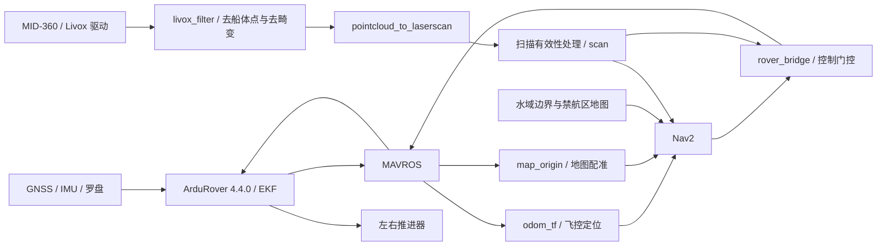

# 从零理解、部署与测试 rx_simu

更新：2026-11-10。读者不需要预先了解本仓库，也不假定目标电脑已经安装 ROS、Nav2、MAVROS 或 Livox 驱动。本文的实船路线是 **Ubuntu 22.04 + ROS 2 Humble + MID-360 + ArduRover 4.4.0**。安装和离线检查可以在没有连接船的电脑上完成；实船数据检查和水试需要对应设备。

目标飞控固定 **ArduRover V4.4.0，源码提交 `d0356316eb0fa34ed1c9f39f7b059b9ae7ba4664`**。本文不刷写飞控，也不假定当前飞控已满足此版本。历史仿真结果不代表第一次部署的电脑、船体或传感器已经通过测试。

阅读顺序：[1. 代码与算法](#1-先理解代码在做什么) → [2. 获取代码](#2-检查平台并获取代码) → [3. ROS/Nav2](#3-检查或安装-ros-2-humble-与-nav2) → [4. MAVROS](#4-检查或安装-mavros) → [5. MID-360 驱动](#5-检查或安装-mid-360-驱动) → [6. 构建和离线测试](#6-构建本仓库并做离线检查) → [7. 实测配置](#7-填写实测配置和地图) → [8. 启动](#8-按顺序启动保持控制关闭) → [9. 数据与规划检查](#9-数据检查规划预览与记录) → [10. 水试](#10-分阶段水试) → [11. 停止](#11-取消停止和关机) → [12. 排障与验证范围](#12-常见问题和验证范围)。

## 1. 先理解代码在做什么

### 1.1 一次导航任务如何执行

你给出地图中的目标位置和航向。Nav2 在地图上找路，并不断计算当前应该向前多快、转弯多快。`rover_bridge` 检查数据是否新鲜、飞控是否允许控制，再把速度请求交给 MAVROS。MAVROS 将 ROS 消息转成 MAVLink，ArduRover 执行速度与转向控制，最终驱动左右推进器。

定位始终来自 **飞控 EKF**。雷达在这条路线中用于检测障碍，不负责 SLAM 或船体定位。`map_origin` 将地图原点与飞控本地坐标对齐；`odom_tf` 保留飞控源时间戳并提供 Nav2 所需的坐标变换。



ROS 的 **topic（话题）**传递持续数据；**service（服务）**完成一次请求，例如查询或切换模式；**action（动作）**执行可反馈、可取消的任务，例如到达目标。**TF** 是坐标系之间的变换，**costmap** 是叠加静态地图、雷达障碍和安全膨胀区后的导航代价地图。

### 1.2 普通导航使用的算法

| 环节 | 当前实现 | 对部署的影响 |
|---|---|---|
| 定位 | 飞控 EKF；MAVROS 输出 `/mavros/local_position/odom` | 必须先校准并验证飞控定位；不启动 AMCL 或把雷达当定位来源 |
| 地图 | `make_water_map` 将米制水域边界、禁航多边形栅格化为 PGM/YAML | 必须测量现场水域；仓库 demo 地图仅用于离线练习 |
| 全局规划 | Navfn，当前 `use_astar=false`，使用 Dijkstra 搜索 | 规划受地图和膨胀层影响；`allow_unknown=false` |
| 局部控制 | DWB 采样前进速度与转速，按加速度约束预测轨迹并评分 | 速度、转速、加减速限制须用本船实验调整；不是 MPC |
| DWB 评分 | 障碍 footprint、贴合路径、接近目标、朝向与振荡等 critics | footprint 必须覆盖船体、推进器及突出物 |
| 任务执行 | 行为树约 1 Hz 重规划，controller 约 10 Hz 跟踪 | 本仓库没有默认启用 Nav2 自动倒车/旋转清障恢复树 |
| 雷达处理 | 去船体点；以飞控 TF 按最多约 5 ms 分组去畸变；空间/时间回波支持过滤 | 不改原始帧时间；不能用当前时间掩盖驱动时钟问题 |
| 扫描投影 | **使用 `pointcloud_to_laserscan`**；高度窗口内的三维点投影为二维扫描 | 原始投影送 `/usv/scan_raw`，经过滤器校验后才发布 `/scan` |
| 控制门控 | command/odom/scan 默认 0.5 s 超时，state 默认 2 s；还检查 TF、帧名、GUIDED、armed | 预览模式没有飞控 setpoint 发布者；输入中断测试要单独测延时 |
| 定点保持 | ArduRover 原生 **LOITER** | 普通到点任务不自动变成持续定点；现场先独立验证 LOITER |

过滤器要求 Livox PointCloud2 中有 `timestamp: FLOAT64`，单位为逐点绝对纳秒。它不是只支持 VRX 的有序雷达格式，也不是 FAST-LIO。没有返回的扫描格保持未知；`observation_persistence=0` 不表示旧障碍会自动消失。

坐标链为：`map → odom → base_stabilized → base_link → 雷达 frame`。地图 +X 向东、+Y 向北，yaw=0 朝东、正角度逆时针。`map_origin` 发布 `map→odom`；`odom_tf` 从飞控姿态拆出 yaw 和剩余 roll/pitch；`sensor_tf` 发布雷达安装外参。每段只能有一个发布者。MAVROS 负责 ENU/FLU 与 NED/FRD 的转换，桥中不要再反转一次转向符号。

### 1.3 Task1 比赛规划是另一套配置

本仓库还包含 RobotX 2026 Safe Passage：先完成入口绕圈，再按红/绿浮标侧向规则通过，最后完成出口绕圈。浮标位置和语义灯态目前由已知观测替身提供；真实 UAV 视觉识别、飞行和 RoboCommand 上报尚未集成。

它使用带 `(x,y,航向,通过颜色状态)` 的**加权 A\* 格点搜索**，以 Dubins 距离等作为启发，逐段检查整船外廓和通过规则；DWB 增加规则与完整船体 critics。LiDAR 聚类、轨迹关联和速度拟合用于动态目标短时常速度预测。任务层比较等待和绕行的预计到达时间，加入转弯、加减速、末端制动和路线切换代价；灯态改变会取消旧路线并重新验证。它不是全局时空最优算法，也不把交通真值交给规划器。

**本文先部署普通 Navfn + DWB 导航。** Task1 的消息包因桥的可选接口而一起编译，但这不等于 Task1 规划器、交通预测或任务许可已经启动。比赛扩展的配置、运行步骤和已有缺口见 [Task1 运行说明](task1/runbook.md)、[交通与路线选择](task1/traffic_avoidance.md)。

### 1.4 从哪里开始读源码

| 路径 | 职责 |
|---|---|
| [`src/usv_nav2`](../src/usv_nav2) | 导航 launch、Navfn/DWB 参数、飞控 odom/TF、控制桥、地图生成 |
| [`src/usv_sim/usv_sim/livox_filter.py`](../src/usv_sim/usv_sim/livox_filter.py) | 可用于真实 MID-360 的点云适配器；包名中有 sim，不代表此节点生成假数据 |
| [`src/usv_sim/usv_sim/map_origin.py`](../src/usv_sim/usv_sim/map_origin.py) | 读取飞控 EKF 原点，计算地图到 odom 的平移；不设置飞控原点 |
| [`src/robotx_task1`](../src/robotx_task1) | 比赛任务机、观测替身、交通跟踪、等待/绕行决策及独立裁判 |
| [`src/robotx_task1_nav`](../src/robotx_task1_nav) | C++ 规则规划器、DWB critics、浮标与预测代价层 |
| [`src/robotx_task1_interfaces`](../src/robotx_task1_interfaces) | 浮标、任务许可、路线评估等 ROS 消息定义 |
| [`config/real`](../config/real) | 实船配置模板；没有默认飞控端口或安装外参 |
| [`scripts/build_hardware.sh`](../scripts/build_hardware.sh) | 构建实船导航三包；不启动设备或控制 |
| [`scripts/hardware_env.sh`](../scripts/hardware_env.sh) | 每个运行终端加载同一套环境 |
| `external/`、`build/`、`install/`、`runs/` | 本机依赖、构建产物和记录；GitHub 克隆不会包含这些内容 |

如果只想在 server 复现实验，使用 [仿真依赖说明](../requirements/README.md) 和 [仿真运行说明](runbook.md)。实船不需要 Gazebo、VRX 或 SITL；不要在实船运行 `bootstrap.py`、`sim_session.py` 或 `validate_*.py` 控船脚本。

## 2. 检查平台并获取代码

以下命令使用 **Bash**。先在目标电脑本机终端执行；是否通过 SSH 登录不影响后续步骤。

```bash
cat /etc/os-release
uname -m
/usr/bin/python3 --version
```

完成标志：Ubuntu **22.04**、系统 Python **3.10**；Orin 为 `aarch64`，离线开发电脑可为 `x86_64`。其他 Ubuntu/ROS 版本不属于这份已对照的流程，先准备匹配的系统；Orin 的 JetPack/驱动应与其镜像兼容，不从这里复制 server 的二进制。

如 `git` 尚未安装，先执行 `sudo apt update && sudo apt install git`。在希望存放项目的目录克隆：

```bash
git clone --branch codex/orin-deployment --single-branch \
  https://github.com/Ericzhaoforu/rx_simu.git "$HOME/rx_simu"
cd "$HOME/rx_simu"
git status --short --branch
git rev-parse HEAD
cp -n config/real/boat.env.example .env.boat
```

本文发布在 **`codex/orin-deployment` 分支**；普通 `git clone` 获取的 `main` 可能没有这些新入口。已有仓库时先 `git status`，切到此分支后用 `git pull --ff-only`；不删除现场改动或重置工作区。`.env.boat`、依赖和实验记录均被 Git 忽略。

后续代码块默认当前目录是仓库根目录。新开终端时先 `cd "$HOME/rx_simu"`；若克隆到了其他目录，替换这一处路径。不要在同一个终端混用仿真 `scripts/env.sh` 和本文的硬件环境。

## 3. 检查或安装 ROS 2 Humble 与 Nav2

### 3.1 先检查

```bash
test -f /opt/ros/humble/setup.bash && echo 'ROS Humble setup exists'
```

若存在，执行 `source /opt/ros/humble/setup.bash`，继续 3.3 检查/补齐包。若不存在，执行 3.2；文件存在只说明安装入口存在，不代表 Nav2 已安装。

### 3.2 没有 ROS 时，先配置软件源并安装

本步骤依据 [ROS 官方 Humble 安装说明](https://github.com/ros2/ros2_documentation/blob/humble/source/Installation/Ubuntu-Install-Debs.rst) 与 [ROS apt 软件源配置](https://github.com/ros2/ros2_documentation/blob/humble/source/Installation/_Apt-Repositories.rst)。已有 ROS 源时先复用，不重复添加同地址不同密钥的源。

```bash
sudo apt update
sudo apt install locales software-properties-common curl ca-certificates python3
sudo locale-gen en_US en_US.UTF-8
export LANG=en_US.UTF-8
sudo add-apt-repository universe

USV_ROS_APT_RELEASE="$(curl -fsSL \
  https://api.github.com/repos/ros-infrastructure/ros-apt-source/releases/latest \
  | python3 -c 'import json,sys; print(json.load(sys.stdin)["tag_name"])')"
curl -fL -o /tmp/rx_ros2_apt_source.deb \
  "https://github.com/ros-infrastructure/ros-apt-source/releases/download/${USV_ROS_APT_RELEASE}/ros2-apt-source_${USV_ROS_APT_RELEASE}.jammy_all.deb"
sudo dpkg -i /tmp/rx_ros2_apt_source.deb
sudo apt update
sudo apt install ros-humble-ros-base
source /opt/ros/humble/setup.bash
```

### 3.3 安装导航和构建依赖

```bash
sudo apt install --no-upgrade \
  build-essential cmake git curl pkg-config \
  python3-dev python3-pip python3-venv python3-setuptools \
  python3-colcon-common-extensions python3-rosdep python3-empy \
  python3-numpy python3-scipy python3-yaml \
  ros-humble-navigation2 ros-humble-nav2-bringup ros-humble-rviz2 \
  ros-humble-pointcloud-to-laserscan ros-humble-rosbag2 \
  ros-humble-rosbag2-storage-default-plugins \
  ros-humble-rosidl-default-generators ros-humble-geographic-msgs
source /opt/ros/humble/setup.bash
ros2 pkg prefix nav2_bringup
ros2 pkg prefix nav2_navfn_planner
ros2 pkg prefix dwb_core
ros2 pkg prefix pointcloud_to_laserscan
```

完成标志：四个命令均输出安装路径。记录实际版本；现有实验基线为 Nav2 **1.1.20**、点云投影 **2.0.1**。apt 仓库可能提供不同构建版本，安装成功不等于这一组合已复现实验。

```bash
dpkg-query -W ros-humble-nav2-bringup ros-humble-pointcloud-to-laserscan
# 只有数据库尚未初始化时执行 sudo rosdep init。
if [ ! -f /etc/ros/rosdep/sources.list.d/20-default.list ]; then
  sudo rosdep init
fi
rosdep update --rosdistro humble
```

若 apt 提议移除 JetPack、内核或 ROS 核心包，先处理源/系统版本冲突，不继续这次安装。不要通过全局 `pip upgrade numpy scipy` 修复 ROS 依赖。

## 4. 检查或安装 MAVROS

MAVROS 是 ROS 与飞控 MAVLink 的接口。**能发现 `mavros_msgs` 不等于已安装 `mavros_node`。**

```bash
source /opt/ros/humble/setup.bash
ros2 pkg prefix mavros
ros2 pkg executables mavros
```

若已有独立工作空间，显式 source 它的 `install/setup.bash` 再检查；不要默认它叫 `robotx_ws`。确认可用后，在 `.env.boat` 中填写 `USV_MAVROS_SETUP='/实际路径/install/setup.bash'`。若使用 apt 安装，保持此变量为空。

找不到可用 MAVROS 时：

```bash
sudo apt install --no-upgrade ros-humble-mavros ros-humble-mavros-extras
source /opt/ros/humble/setup.bash
ros2 pkg executables mavros
```

安装 GeographicLib 地球重力模型数据；先检查，缺失再安装：

```bash
if [ ! -r /usr/share/GeographicLib/geoids/egm96-5.pgm ]; then
  sudo "$(ros2 pkg prefix mavros)/lib/mavros/install_geographiclib_datasets.sh"
fi
test -r /usr/share/GeographicLib/geoids/egm96-5.pgm && echo 'egm96-5 present'
```

完成标志：可找到 `mavros_node` 和 geoid 数据，且节点动态库没有 `not found`：

```bash
ldd "$(ros2 pkg prefix mavros)/lib/mavros/mavros_node"
python3 - <<'PY_VERSION'
from ament_index_python.packages import get_package_share_directory
from pathlib import Path
import xml.etree.ElementTree as ET
for name in ('mavros', 'mavros_msgs', 'nav2_bringup'):
    print(name, ET.parse(Path(get_package_share_directory(name))/'package.xml').getroot().findtext('version'))
PY_VERSION
```

MAVROS 2.14.0 和仿真用 2.16.0 是已记录过的不同环境，不能写成每台电脑都已安装。复用源码版本时，`mavros` 与 `mavros_msgs` 应来自匹配的 overlay，后续按实际话题和服务验证。此处还不连接飞控。

## 5. 检查或安装 MID-360 驱动

### 5.1 已有驱动的检查

```bash
ros2 pkg prefix livox_ros_driver2
ros2 pkg executables livox_ros_driver2
```

若已存在，记录安装路径、源码 SHA 和本地修改，在 `.env.boat` 中填写 `USV_LIVOX_SETUP`；若驱动直接装在当前系统 ROS 前缀，可留空。安装在独立前缀的 SDK 还需填写 `USV_LIVOX_SDK_PREFIX`。然后跳到 5.3。此时只验证软件，不假定雷达在线。

### 5.2 没有驱动时，在本仓库忽略目录内独立构建

[Livox 官方驱动说明](https://github.com/Livox-SDK/livox_ros_driver2/blob/21445540f0d100dc86a7e6df312dd70bbdb4afdf/README.md) 要求先安装 SDK2。本流程使用下面两个固定提交，不把某个旧 SDK tag 与较新的驱动混用：

| 依赖 | 固定提交 |
|---|---|
| Livox SDK2 | `c0796f04c143143899c87a773d9f6b7136453c0b` |
| livox_ros_driver2 | `21445540f0d100dc86a7e6df312dd70bbdb4afdf` |

机器可读版本记录在 [hardware_dependencies.lock.json](../config/hardware_dependencies.lock.json)。这对提交已在 server x86_64 构建通过，ARM64 和真实雷达仍需在目标机按后续步骤验证。

以下目录只用于这次独立安装；若已存在，先核对其 SHA，从构建步骤继续，不覆盖其他项目。官方驱动的 `build.sh` 会清理其上级工作空间构建目录，所以这里显式调用 colcon。

```bash
sudo apt install --no-upgrade libpcl-dev libapr1-dev \
  ros-humble-pcl-conversions ros-humble-ament-cmake-auto
source /opt/ros/humble/setup.bash
cd "$HOME/rx_simu"
mkdir -p external/hardware_livox_ws/src

git clone https://github.com/Livox-SDK/Livox-SDK2.git external/hardware_livox_sdk2
git -C external/hardware_livox_sdk2 checkout --detach c0796f04c143143899c87a773d9f6b7136453c0b
cmake -S external/hardware_livox_sdk2 -B external/hardware_livox_sdk2/build \
  -DCMAKE_BUILD_TYPE=Release \
  -DCMAKE_INSTALL_PREFIX="$PWD/external/hardware_livox_sdk2/install"
cmake --build external/hardware_livox_sdk2/build -j2
cmake --install external/hardware_livox_sdk2/build

git clone https://github.com/Livox-SDK/livox_ros_driver2.git \
  external/hardware_livox_ws/src/livox_ros_driver2
git -C external/hardware_livox_ws/src/livox_ros_driver2 checkout --detach \
  21445540f0d100dc86a7e6df312dd70bbdb4afdf
cp external/hardware_livox_ws/src/livox_ros_driver2/package_ROS2.xml \
  external/hardware_livox_ws/src/livox_ros_driver2/package.xml

PYTHONNOUSERSITE=1 /usr/bin/python3 -m colcon \
  --log-base external/hardware_livox_ws/log build \
  --base-paths external/hardware_livox_ws/src \
  --build-base external/hardware_livox_ws/build \
  --install-base external/hardware_livox_ws/install \
  --packages-select livox_ros_driver2 --executor sequential \
  --cmake-args -DROS_EDITION=ROS2 -DDISTRO_ROS=humble -DBUILD_TESTING=OFF \
  -DPython3_EXECUTABLE=/usr/bin/python3 -DPYTHON_EXECUTABLE=/usr/bin/python3 \
  -DLIVOX_LIDAR_SDK_LIBRARY="$PWD/external/hardware_livox_sdk2/install/lib/liblivox_lidar_sdk_shared.so" \
  -DLIVOX_LIDAR_SDK_INCLUDE_DIR="$PWD/external/hardware_livox_sdk2/install/include"
```

编译通过后编辑 `.env.boat`，设为以下两个值（这是本流程创建的目录，不是假定已有环境）：

```bash
export USV_LIVOX_SETUP="$USV_WORKSPACE/external/hardware_livox_ws/install/setup.bash"
export USV_LIVOX_SDK_PREFIX="$USV_WORKSPACE/external/hardware_livox_sdk2/install"
```

### 5.3 验证发现和动态库

```bash
source scripts/hardware_underlay.sh
ros2 pkg prefix livox_ros_driver2
ros2 pkg executables livox_ros_driver2
ldd "$(ros2 pkg prefix livox_ros_driver2)/lib/livox_ros_driver2/livox_ros_driver2_node"
```

完成标志：可执行文件存在，`ldd` 没有 `not found`。后续明确使用 `xfer_format=0` 的 PointCloud2。CustomMsg 不能只靠 remap 改成 PointCloud2；逐点时间格式还要用真实消息核验。

## 6. 构建本仓库并做离线检查

### 6.1 构建三个普通导航包

先确认 `.env.boat` 中仅填写了**实际存在**的可选 overlay 路径；硬件测量值可暂时空着。source 环境本身不会启动硬件。

```bash
cd "$HOME/rx_simu"
source scripts/hardware_underlay.sh
rosdep install --from-paths src/robotx_task1_interfaces src/usv_nav2 src/usv_sim \
  --ignore-src --rosdistro humble -r -y --skip-keys python3-pymavlink-pip
bash scripts/build_hardware.sh
source scripts/hardware_env.sh
ros2 pkg prefix usv_nav2
ros2 pkg prefix usv_sim
ros2 pkg prefix robotx_task1_interfaces
```

`pymavlink` 由构建脚本按 [hardware-pip.txt](../requirements/hardware-pip.txt) 安装到 `.venv`，随后运行不跳过该项的 rosdep check。使用系统 Python 3.10 和系统 NumPy/SciPy，通过 `PYTHONNOUSERSITE=1` 排除 `~/.local` 干扰。构建目录为 `build/hardware`、`install/hardware`，不覆盖原仿真构建；结果、版本和日志在 `runs/hardware_build_<时间>/`。

完成标志：colcon 显示 **3 packages finished**；三个安装路径均指向本仓库 `install/hardware`。脚本未检测到 Livox 时允许构建导航软件，但会提示补装；这不能当作传感器阶段通过。

### 6.2 逻辑测试、地图生成和 launch 参数检查

```bash
(cd src/usv_nav2 && python3 -m unittest discover -s test -v)
python3 -m unittest discover -s scripts -p 'test_hardware_setup.py' -v
mkdir -p runs/offline_check
ros2 run usv_nav2 make_water_map \
  src/usv_nav2/maps/demo_area.json runs/offline_check/demo
ros2 launch usv_nav2 navigation.launch.py --show-args
```

完成标志：测试通过；生成 demo.pgm/demo.yaml；能列出 navigation 的启动参数。**demo 地图不用于实船；这一步没有验证定位、避障或到点。**

### 6.3 验证预览桥确实不向飞控输出

终端 A：

```bash
cd "$HOME/rx_simu"
source scripts/hardware_env.sh
export ROS_DOMAIN_ID=162 ROS_LOCALHOST_ONLY=1
ros2 run usv_nav2 rover_bridge --ros-args \
  -p use_sim_time:=false -p enable_control:=false \
  -p enable_stationkeeping:=false -p require_task_permission:=false
```

终端 B（先同样 cd/source，再设置同一 domain）：

```bash
export ROS_DOMAIN_ID=162 ROS_LOCALHOST_ONLY=1
ros2 param get /rover_bridge enable_control
ros2 topic echo /usv/control_status --once
ros2 node info /rover_bridge
```

完成标志：控制参数为 false，状态以 `PREVIEW:` 开头，发布者包含 `/usv/setpoint_preview`，**不包含 `/mavros/setpoint_raw/local`**。没有传感器时零预览是预期结果。此处不启动 MAVROS，不发布假 odom，不解锁。检查后在 A 按 Ctrl-C，关闭两个终端；后续新终端重新 source，使用实船 domain 62。

## 7. 填写实测配置和地图

```bash
cd "$HOME/rx_simu"
# 首次创建；-n 保留已有现场设置。
cp -n config/real/boat.env.example .env.boat
nano .env.boat  # 没有 nano 时可用其他文本编辑器
```

`.env.boat` 和 `runs/` 已被 Git 忽略。必须填的值：

| 变量 | 填写依据 |
|---|---|
| `USV_FCU_URL`、`USV_FCU_SYSID` | 实际 MAVLink 连接和飞控 SYSID。例如串口 URL 形如 `/dev/serial/by-id/<确认的接口>:<确认的波特率>`；不能直接套 SITL 的 localhost UDP |
| `USV_MAVROS_SETUP` / `USV_LIVOX_SETUP` / `USV_LIVOX_CONFIG` | 第 4–5 步确认的可选 overlay 与本仓库独立配置副本 |
| `USV_LIDAR_FRAME` 和 6 个安装量 | 实际点云 frame、相对 `base_link` 的 x/y/z（m）和 roll/pitch/yaw（rad） |
| `USV_FOOTPRINT` | `base_link` 中的实测船体多边形，包含推进器和突出物；不能套 WAM-V，也不能仅凭“1.2×0.7 m”假定参考点位于中心 |
| `USV_MARK_MIN_Z/MAX_Z` | `base_stabilized` 中的障碍高度窗口；先看真实点云，确认不会过滤掉浮标和低矮障碍 |
| `USV_MAP_LAT/LON`、`USV_MAP_YAML` | 实测地图原点经纬度和地图文件；地图 x 向东、y 向北，单位 m |
| `USV_LIDAR_NIC` / `USV_LIDAR_HOST_CIDR` / `USV_LIDAR_IP` | 雷达直连网卡、该网卡的 IP/掩码和实际雷达 IP；SSH/Tailscale 地址不用于此处 |

`base_link` 应对应 FCU 状态所使用的机体参考点。GNSS 杆臂、罗盘方向、雷达外参和 footprint 都要相对此点定义。Livox SDK 的外参保持零、由 TF 应用一次安装变换，避免 SDK 和 TF 重复转换。

先用 `ip -brief address` 找到雷达直连网卡。填写与实际雷达同网段且不冲突的地址；例如 `192.168.1.5/24` 只是一种配置，不代表设备出厂地址。使用 NetworkManager 的电脑可创建专用连接；已有正确连接时复用，不重复创建：

```bash
source scripts/hardware_env.sh
nmcli connection show
# 仅在没有本雷达的正确连接配置时执行；不要选择 SSH 所用网卡。
sudo nmcli connection add type ethernet con-name rx-lidar \
  ifname "${USV_LIDAR_NIC:?填写雷达网卡}" \
  ipv4.method manual ipv4.addresses "${USV_LIDAR_HOST_CIDR:?填写主机IP/掩码}" \
  ipv4.never-default yes ipv6.method disabled
sudo nmcli connection up rx-lidar
```

没有 `nmcli` 时按该系统正在使用的 netplan/networkd 配置同样的专用静态地址，不为了本步骤切换网络管理器。网线有链路、`ip route get` 指向正确网卡且使用填写的源 IP 才继续；仅 SSH 连通不能证明雷达网络连通。

先复制雷达配置，再核对网卡、目标 IP 和 UDP 端口；不改动旧工作空间的配置：

```bash
source scripts/hardware_env.sh
mkdir -p runs/hardware_config
cp -n "$(ros2 pkg prefix livox_ros_driver2)/share/livox_ros_driver2/config/MID360_config.json" \
  "$USV_LIVOX_CONFIG"
ip -brief address
ip route get "${USV_LIDAR_IP:?填写雷达实际IP}"
ss -lunp
ls -l /dev/serial/by-id/
```

将**独立副本**中的主机和雷达 IP 改成 `.env.boat` 的实际值；端口沿用这份固定驱动的 MID360 配置，不改旧工作空间：

```bash
python3 - <<'PY'
import ipaddress, json, os
from pathlib import Path
host = ipaddress.ip_interface(os.environ['USV_LIDAR_HOST_CIDR'])
lidar = ipaddress.ip_address(os.environ['USV_LIDAR_IP'])
assert host.version == 4 and lidar.version == 4
assert lidar in host.network and lidar != host.ip
p = Path(os.environ['USV_LIVOX_CONFIG'])
cfg = json.loads(p.read_text())
for key in ('cmd_data_ip', 'push_msg_ip', 'point_data_ip', 'imu_data_ip'):
    cfg['MID360']['host_net_info'][key] = str(host.ip)
cfg['lidar_configs'][0]['ip'] = str(lidar)
cfg['lidar_configs'][0]['extrinsic_parameter'] = dict(roll=0, pitch=0, yaw=0, x=0, y=0, z=0)
p.write_text(json.dumps(cfg, indent=2)+'\n')
PY
```

飞控使用实际 MAVLink 端口和波特率，先用 `ls -l /dev/serial/by-id/`、`id -nG` 检查设备与权限。若串口属于 dialout 而账号不在该组，执行 `sudo usermod -aG dialout "$USER"` 后重新登录。通用 USB 串口名不能证明它就是飞控；只在确认接线后填写 `USV_FCU_URL`。

使用实测的可航行边界和禁航多边形，按 [demo_area.json 的结构](../src/usv_nav2/maps/demo_area.json) 编写 `runs/hardware_config/area.json`。坐标均为相对 `USV_MAP_LAT/LON` 的东、北距离（m）；`navigable_boundary` 为依次连接的边界点，`exclusions` 为多个禁航多边形。可从下面的空模板开始，必须填入至少三个实测边界点；空模板会被拒绝，不产生可航地图。

```json
{"resolution": 0.2, "padding": 1.0, "navigable_boundary": [], "exclusions": []}
```

在编辑器中保存上述文件并填好边界后生成地图；不要直接把仓库 demo 地图用在实船。

```bash
source scripts/hardware_env.sh
ros2 run usv_nav2 make_water_map \
  runs/hardware_config/area.json runs/hardware_config/water
```

`map_origin` 只把飞控报告的真实 EKF 原点平移到地图原点，**不设置飞控原点，不旋转地图，不提高 GNSS 精度**。若地图不是 ENU 朝向，先完成地图坐标转换；不能用改 frame 名或固定零变换假装对齐。飞控原点变化时停止任务并重新核验配准。

填好 `.env.boat` 并生成真实地图后，使用配置生成器。它检查必填项、地图是否存在、船体凸包和速度上限；不会自动猜测外参或打开控制：

```bash
source scripts/hardware_env.sh
python3 scripts/prepare_hardware.py --check
python3 scripts/prepare_hardware.py
```

完成标志：`runs/hardware_config/nav2.yaml` 和 `livox_filter.yaml` 已生成，`enable_control`、`enable_stationkeeping`、`require_task_permission` 均为 false。已存在的文件不会被覆盖；调整配置时先备份这两份文件，再重新生成。footprint 应按外缘依序填写严格凸包，包含推进器；不重复首点。

初始速度上限 **0.2 m/s / 0.2 rad/s**、padding **0.2 m**、膨胀 **1.0 m** 是低速调试初值，尚未由本船停车/转弯试验验证。全局 Navfn、局部 DWB；目标容差保留 0.5 m / 0.25 rad，超时保留 command/odom/scan 0.5 s、state 2 s。不得通过放宽数据超时或缩小 footprint 让异常消失。

## 8. 按顺序启动，保持控制关闭

顺序为 **现场飞控检查 → MAVROS → 地图配准/安装 TF → 真实雷达 → 导航预览 → 点云过滤 → 扫描投影 → 数据检查与记录 → 现场启用控制**。所有长驻命令各占一个终端或 tmux 窗口。每个窗口先执行：

```bash
cd "$HOME/rx_simu"
source scripts/hardware_env.sh
```

该配置使用 `ROS_DOMAIN_ID=62`、`ROS_LOCALHOST_ONLY=1`，ROS 节点都在 Orin 上；Tailscale 只负责 SSH。若要电脑直接运行 RViz，需要另外配置双方 DDS 网络，不把改成 `ROS_LOCALHOST_ONLY=0` 当作已经打通发现。现场先通过遥控器确认 MANUAL / HOLD 的接管和推进器停止能力；岸上阶段保持 disarm，测试推进器时由现场人员单独安排。

**A. MAVROS，只建立真实 FCU 数据链。** 确认旧 MAVROS、MAVProxy 或 router 没有独占同一串口；不启动第二个控制器。

```bash
ros2 run mavros mavros_node --ros-args \
  --params-file config/real/mavros.yaml \
  -p fcu_url:="${USV_FCU_URL:?填写真实FCU连接}" \
  -p target_system_id:="${USV_FCU_SYSID:?填写真实SYSID}"
```

另一个终端检查：

```bash
ros2 topic echo /mavros/state --once --qos-reliability best_effort
ros2 service call /mavros/vehicle_info_get mavros_msgs/srv/VehicleInfoGet '{get_all: true}'
ros2 service call /mavros/param/pull mavros_msgs/srv/ParamPull '{force_pull: false}'
ros2 param dump /mavros/param > runs/hardware_config/fcu_before.yaml
ros2 topic echo /mavros/local_position/odom --once --qos-reliability best_effort
```

确认 `connected=true`、初始 `armed=false`、真实 SYSID 和 **4.4.0 / d0356316**；`flight_custom_version` 或地面站固件信息用于核对提交。里程计必须是 `odom → base_link`，并有正确的 ENU / FLU 方向和新鲜时间。检查实际船舶类别、左右输出、正反转、RC 与 GCS 失联行为、GNSS/EKF 状态；不整包导入 SITL 参数，尤其不用仿真的 `GPS_TYPE=14` 和 GPS_INPUT 注入。

**B. 地理配准；C. 雷达安装 TF，分别运行。**

```bash
# B
ros2 run usv_sim map_origin --ros-args -p use_sim_time:=false \
  -p origin_latitude:="${USV_MAP_LAT:?填写地图纬度}" \
  -p origin_longitude:="${USV_MAP_LON:?填写地图经度}"
```

```bash
# C：已有 URDF 提供同一变换时省略，确保只有一个发布者。
ros2 launch usv_nav2 sensor_tf.launch.py \
  lidar_frame:="${USV_LIDAR_FRAME:?}" \
  x:="${USV_LIDAR_X:?}" y:="${USV_LIDAR_Y:?}" z:="${USV_LIDAR_Z:?}" \
  roll:="${USV_LIDAR_ROLL:?}" pitch:="${USV_LIDAR_PITCH:?}" yaw:="${USV_LIDAR_YAW:?}"
```

**D. 真实 MID-360 驱动。** 本命令显式选择带逐点时间的 PointCloud2，不启动驱动附带 RViz；只运行一个雷达驱动实例。

```bash
ros2 run livox_ros_driver2 livox_ros_driver2_node --ros-args \
  -r __node:=livox_lidar_publisher -p use_sim_time:=false \
  -p xfer_format:=0 -p multi_topic:=0 -p data_src:=0 \
  -p publish_freq:=10.0 -p output_data_type:=0 \
  -p frame_id:="${USV_LIDAR_FRAME:?}" \
  -p user_config_path:="${USV_LIVOX_CONFIG:?}"
```

`xfer_format=0` 和参数名已对照 [固定提交的 Livox ROS 2 启动文件](https://github.com/Livox-SDK/livox_ros_driver2/blob/21445540f0d100dc86a7e6df312dd70bbdb4afdf/launch_ROS2/rviz_MID360_launch.py)；时间字段对照 [同一提交的发布代码](https://github.com/Livox-SDK/livox_ros_driver2/blob/21445540f0d100dc86a7e6df312dd70bbdb4afdf/src/lddc.cpp)。CustomMsg 不能仅靠重映射变成 PointCloud2。保证 MID 与 Orin / MAVROS 处在可比较的时间基准，检查实际 PTP/GNSS/驱动时钟处理；仅 Orin 系统 NTP 正常不能证明雷达已同步。不能用“当前时间”覆盖旧消息。

**E. 导航预览。** 此步骤建立 odom TF 和 Nav2；控制默认关闭，即使输入齐全也没有向 FCU 的 setpoint 发布者。

```bash
ros2 launch usv_nav2 navigation.launch.py \
  map:="${USV_MAP_YAML:?}" params_file:="$USV_WORKSPACE/runs/hardware_config/nav2.yaml" \
  use_sim_time:=false enable_control:=false rviz:=false
```

TF 链为 `map → odom → base_stabilized → base_link → <lidar_frame>`：第一段由 map_origin、船体两段由 odom_tf、最后一段由安装 TF/URDF 发布。MAVROS 的位置 TF 已关闭，不能再让其他定位器重复发布相同边。

**F. 船体过滤与 FCU TF 去畸变；G. pointcloud_to_laserscan，分别运行。**

```bash
# F：虽然位于 usv_sim 包，这个适配器读取真实驱动消息，不生成真值。
ros2 run usv_sim livox_filter --ros-args \
  --params-file "$USV_WORKSPACE/runs/hardware_config/livox_filter.yaml"
```

```bash
# G：必须输出到 /usv/scan_raw，之后由过滤器保留源时间并发布 /scan。
ros2 launch usv_nav2 cloud_to_scan.launch.py \
  cloud_topic:=/usv/lidar/filtered scan_topic:=/usv/scan_raw \
  target_frame:=base_stabilized use_sim_time:=false \
  min_height:="${USV_MARK_MIN_Z:?}" max_height:="${USV_MARK_MAX_Z:?}" \
  range_min:=0.3 range_max:=20.0
```

完整数据流：真实 MID → `/livox/lidar` → livox_filter（实测船体、飞控 TF、回波支持过滤）→ `/usv/lidar/filtered` → pointcloud_to_laserscan → `/usv/scan_raw` → `/scan` → Nav2 costmap。飞控 → MAVROS EKF odom → odom_tf → `/usv/odom` / TF。控制开启后才有 Nav2 → `/usv/cmd_vel` → rover_bridge → MAVROS → ArduRover → 推进器。

此处普通 Nav2 使用 LaserScan 障碍层，**没有启用 Task1 的 Voxel / 交通预测层**。过滤器还发布 marking/clearing 云，但不能将这些发布话题误当成普通参数已订阅。无返回保持未知，不能把无回波水面解释为已证明可通行；现有仿真已记录的动态残留问题仍需实测。

## 9. 数据检查、规划预览与记录

```bash
ros2 node list
ros2 param get /mavros use_sim_time
ros2 param get /rover_bridge use_sim_time
ros2 param get /livox_filter use_sim_time
ros2 topic info /livox/lidar -v
ros2 topic echo /livox/lidar --once --field fields --qos-reliability best_effort
ros2 topic info /scan -v
ros2 topic echo /scan --once --field header --qos-reliability best_effort
ros2 topic echo /usv/control_status --once
ros2 topic echo /usv/map_alignment --once --qos-durability transient_local
ros2 run tf2_ros tf2_echo map base_link
```

`tf2_echo` / `topic hz` 等持续输出命令用 Ctrl-C 结束。另测 `/livox/lidar`、`/scan` 和 `/usv/odom` 的频率；10 Hz 只是目标值，还要检查采集源龄、最大间隔和 TF 查找失败。`timestamp` 必须是 FLOAT64 绝对 ns，位于帧 header 至其后约 0.12 s 范围；过滤器会拒绝不兼容格式。所有实机节点 `use_sim_time=false`，不启动 `/clock`。预览状态在 disarm / 非 GUIDED 时为零属于门控正常，规划输出和路径可单独检查。

```bash
ros2 lifecycle get /map_server
ros2 lifecycle get /planner_server
ros2 lifecycle get /controller_server
ros2 lifecycle get /bt_navigator
# 有本地桌面或已配置显示时才运行 RViz；Fixed Frame 设 map。
ros2 run rviz2 rviz2 -d "$(ros2 pkg prefix usv_nav2)/share/usv_nav2/rviz/navigation.rviz"
```

四个 lifecycle 节点应为 active。在 RViz 对比船体朝向、实测标志物、雷达障碍与地图；推动/转动船时，位置和方向变化必须一致。全 NaN 扫描、明显时钟漂移或地图错位不能进入控制阶段。

选取实测地图中的安全目标，将坐标与航向填入下列变量，生成通用目标文件。不是把当前位置硬编码为原点，也不默认“前进 5 m 就等于 map x=5”。

```bash
export USV_GOAL_X='' USV_GOAL_Y='' USV_GOAL_YAW=''
# 填好上面三项后执行；yaw 为 ENU 弧度，0 朝东、pi/2 朝北。
python3 - <<'PY'
import json, math, os
from pathlib import Path
x,y,a = [float(os.environ['USV_GOAL_'+k]) for k in ('X','Y','YAW')]
assert all(map(math.isfinite, (x,y,a)))
pose = dict(header=dict(frame_id='map'), pose=dict(
    position=dict(x=x,y=y,z=0.0), orientation=dict(x=0.0,y=0.0,z=math.sin(a/2),w=math.cos(a/2))))
root = Path(os.environ['USV_WORKSPACE'])/'runs/hardware_config'
(root/'goal.json').write_text(json.dumps(dict(pose=pose)))
(root/'plan.json').write_text(json.dumps(dict(goal=pose,planner_id='GridBased',use_start=False)))
PY
ros2 action send_goal /compute_path_to_pose nav2_msgs/action/ComputePathToPose \
  "$(cat runs/hardware_config/plan.json)" --feedback
```

规划 action 只请求路径，不执行运动。检查禁航区、完整 footprint、膨胀、局部障碍和目标朝向。移动测试用实体模拟障碍后再移开，确认原位置确实清除；`observation_persistence=0` 不会使障碍格自动到期，禁止通过反复清图掩盖失败。

记录终端先启动，再开始任何水试。每次使用独立目录，不覆盖既有记录：

```bash
USV_RUN="$USV_WORKSPACE/runs/hardware_$(date +%Y%m%d_%H%M%S)"
mkdir -p "$USV_RUN"
git rev-parse HEAD > "$USV_RUN/revision.txt"
cp -r runs/hardware_config "$USV_RUN/config"
ros2 bag record -o "$USV_RUN/bag" \
  /mavros/state /mavros/local_position/odom /mavros/global_position/global \
  /mavros/imu/data /mavros/rc/out /mavros/setpoint_raw/local \
  /mavros/setpoint_raw/target_global /usv/odom /usv/cmd_vel \
  /usv/setpoint_preview /usv/control_status /usv/map_alignment \
  /livox/lidar /usv/lidar/filtered /scan /tf /tf_static \
  /map /plan /local_costmap/costmap /global_costmap/costmap
```

目标反馈话题未由 FCU 输出时不能用空 bag 证明目标不变，应检查 MAVLink 消息流。记录时同步保存现场视频、独立位置测量、风流情况、操作时刻和急停方式；MAVROS / EKF 自身位置不是独立真值。RC 输出或 ESC 指令也不等于实测牛顿推力。

## 10. 分阶段水试

| 阶段 | 操作 | 通过条件 / 记录 |
|---|---|---|
| 岸上接线与静态感知 | disarm；看版本、状态、点云、TF、地图 | 无重复控制器/TF；时间正确；实体方位和尺寸匹配；船体回波被正确过滤 |
| 现场人工操船 | 先 MANUAL / HOLD，单侧/双侧、正反转、归零 | 左右和 yaw 符号正确；测停车时间/距离、转弯半径；确认 RC 接管和断链行为 |
| 独立原生 LOITER | 开阔水域，Nav2 未执行任务；现场进入 LOITER | 三次、每次至少 120 s；记录固定目标、实际轨迹、最大/RMS 偏差和推力；不每秒重设定点 |
| 普通 Nav2 单目标 | 低速，先 3–5 m 合适目标，再延长 | 至少三次；位置 ≤0.5 m、航向 ≤0.25 rad 是待验目标；独立测量，记录到点后至少 10 s 漂移 |
| 多途经点、取消、不可达 | 新鲜目标；主动取消与封闭目标 | 正确退出；分别记录零指令、推进器响应、实际停止，不能互相替代 |
| 静态障碍 | 已测停车余量基础上绕行 | 无接触，记录最小净空、低障碍漏检、地图清除；失败先复现排查 |
| 动态障碍与输入故障 | 前述通过后，现场有人接管；逐项中断 | 测 scan/odom/command 中断发零 ≤0.6 s、state ≤2.1 s；进程退出另测飞控行为，不假定同一时延 |
| Task1 / 风浪 / GNSS 组合 | 后续单独验收 | 当前不把开放水面动态清除、真实灯态/UAV、原生保持与任务的实机结合写成已通过 |

### 独立 LOITER

优先由现场遥控器切换；现场按正常 arming checks 解锁后才会主动定点。需从 MAVROS 进行模式请求时，先取消全部导航动作，再请求并检查 `/mavros/state` 实际变为 LOITER：

```bash
ros2 service call /navigate_to_pose/_action/cancel_goal action_msgs/srv/CancelGoal '{}'
ros2 service call /navigate_through_poses/_action/cancel_goal action_msgs/srv/CancelGoal '{}'
ros2 service call /mavros/set_mode mavros_msgs/srv/SetMode \
  "{base_mode: 0, custom_mode: 'LOITER'}"
ros2 topic echo /mavros/state --once --qos-reliability best_effort
```

无活动 Nav2 节点时省略前两条。`mode_sent=true` 只说明请求已发送，实际状态确认才算模式切换。实船 `LOIT_RADIUS/LOIT_TYPE/LOIT_SPEED_GAIN` 先记录现值并依据水试调整，不能默认复制 WAM-V 的 0.3 m 半径；原生 LOITER 会改变船头方向，其转向/纠偏空间必须足够。

HOLD 不补偿风流，GUIDED 零速度也不是定点。当前桥没有通用 RTK/EKF 质量门控；Fixed 不能排除缓慢一致性偏差。测试人员必须监视真实定位质量和漂移，不能将桥的“数据新鲜”当作“位置正确”。GPS 失锁后的 HOLD 与重新定点是不同操作，不默认自动恢复。

### 普通 Nav2 控制

现场确认可控、记录运行、输入和路径检查通过后：取消旧动作，切 HOLD 并按现场程序 disarm，Ctrl-C 停止 **E 导航预览**，确认旧 rover_bridge 已退出，再以相同参数启动控制实例；不同时保留两个桥。

```bash
ros2 launch usv_nav2 navigation.launch.py \
  map:="$USV_MAP_YAML" params_file:="$USV_WORKSPACE/runs/hardware_config/nav2.yaml" \
  use_sim_time:=false enable_control:=true rviz:=false
```

`enable_control` 在节点创建时决定是否建立输出发布者；当前实现没有动态重配置回调，**不能靠 `ros2 param set` 就认为已切换控制**。重新启动后再次确认生命周期、TF、扫描与状态。

以下模式请求和解锁仅在现场水试条件满足后执行；安装、构建和前述预览阶段不执行这些命令：

```bash
ros2 service call /mavros/set_mode mavros_msgs/srv/SetMode \
  "{base_mode: 0, custom_mode: 'GUIDED'}"
ros2 service call /mavros/cmd/arming mavros_msgs/srv/CommandBool '{value: true}'
ros2 topic echo /mavros/state --once --qos-reliability best_effort
# 确认 armed=true、GUIDED 且现场允许后，发送刚重新核验的目标。
ros2 action send_goal /navigate_to_pose nav2_msgs/action/NavigateToPose \
  "$(cat runs/hardware_config/goal.json)" --feedback
```

不使用 force-arm，不关闭 arming checks。恢复 GUIDED 时取消旧导航并重新生成目标/路径；自动 Task1 的 `require_task_permission`、`enable_stationkeeping`、252 号专用心跳属于另一套完整模式合同，**本实机普通导航配置均关闭**。仅手工打开 `enable_stationkeeping` 会缺少新鲜许可和飞控失联配置，不能照搬仿真 `--task1-loiter`。

普通模式下 MAVROS 还活着时，其 GCS 心跳可能掩盖导航桥退出；实船必须分别测桥退出、MAVROS 退出和整机断链。仿真可选模式的 252 号心跳 / FS 参数不能整包覆盖现有遥控与地面站保护。

### 多途经点与中断检查

单目标通过后，按 `[[x,y,yaw], ...]` 格式填写 `runs/hardware_config/waypoints_xy_yaw.json`（至少两个实测安全目标，单位 m、rad）。先结束上一任务，再生成动作请求并执行：

```bash
python3 - <<'PY'
import json, math
from pathlib import Path
p = Path('runs/hardware_config')
points = json.loads((p/'waypoints_xy_yaw.json').read_text())
assert len(points) >= 2
poses = []
for x, y, yaw in points:
    assert all(math.isfinite(v) for v in (x, y, yaw))
    poses.append(dict(header=dict(frame_id='map'), pose=dict(
        position=dict(x=x, y=y, z=0.0),
        orientation=dict(x=0.0, y=0.0, z=math.sin(yaw/2), w=math.cos(yaw/2)))))
(p/'waypoints.json').write_text(json.dumps(dict(poses=poses)))
PY
ros2 action send_goal /navigate_through_poses nav2_msgs/action/NavigateThroughPoses \
  "$(cat runs/hardware_config/waypoints.json)" --feedback
```

取消用下一节的 cancel_goal 命令。不可达测试先在控制关闭的规划预览中选择禁航区内目标，预期返回规划失败，不进入控制阶段。

输入中断先在预览模式做：停止 G 扫描投影终端，观察 `/scan` 停更及桥状态；恢复 G 后检查源时间和输入恢复。水试时再记录最后一帧有效 scan 至零 setpoint 的时间。停止整个 MAVROS 同时中断多类输入，不能当作单独的 odom/state 超时试验；桥/MAVROS 进程退出是另两项飞控保护实验。每项均记录命令、推力/电机反馈和船体运动，失败后先恢复并排查再继续。

## 11. 取消、停止和关机

先结束动作并由现场确认安全模式/推进器状态，再停数据链。紧急情况优先用现场 RC / 硬件接管，不能只依赖 SSH：

```bash
ros2 service call /navigate_to_pose/_action/cancel_goal action_msgs/srv/CancelGoal '{}'
ros2 service call /navigate_through_poses/_action/cancel_goal action_msgs/srv/CancelGoal '{}'
ros2 service call /mavros/set_mode mavros_msgs/srv/SetMode \
  "{base_mode: 0, custom_mode: 'HOLD'}"
ros2 topic echo /mavros/state --once --qos-reliability best_effort
# 在现场确认可 disarm 时执行，随后检查实际反馈。
ros2 service call /mavros/cmd/arming mavros_msgs/srv/CommandBool '{value: false}'
```

若有风流需要继续定点，现场明确选择 LOITER 并保持必要定位/数据链，不能把上述 HOLD 流程理解为保持位置。常规关闭顺序：导航/桥 → 点云投影/过滤 → 雷达驱动 → 安装 TF/配准 → MAVROS；记录器最后 Ctrl-C 正常结束，检查 `ros2 bag info <bag目录>` 和日志后再关机。不使用 `killall` 清理整台 Orin 的其他任务。

## 12. 常见问题和验证范围

| 现象 | 先检查什么 | 处理方向 / 通过条件 |
|---|---|---|
| `ros2: command not found` | `/opt/ros/humble/setup.bash` 是否存在并已 source | 回到第 3 步；不要把其他 ROS 发行版混入终端 |
| `Package ... not found` | 当前终端的 setup、构建 summary、`ros2 pkg prefix` | 每个终端重新 `source scripts/hardware_env.sh`；只有源码目录不算安装 |
| `robotx_ws` 不存在 | `.env.boat` 的 overlay 值 | apt 安装留空；源码安装填写自己的实际路径，本流程不默认该目录存在 |
| SciPy 报 NumPy 版本警告 | `python3 -c 'import numpy,scipy; print(numpy.__version__,numpy.__file__,scipy.__version__)'` | 确认 Python 指向本仓库 `.venv`，`PYTHONNOUSERSITE=1`；不修改全局科学计算库 |
| rosdep 找不到 pymavlink | 仓库是否更新、rosdep 数据是否刷新 | 使用 `python3-pymavlink-pip`；构建脚本在 venv 内安装和检查，不用错误的 `python3-pymavlink` 键 |
| `kLivoxLidarDoubleEchoData` 未定义 | SDK 与驱动的源码 SHA、CMake 缓存中的 include 路径 | 第 5 步两个 SHA 必须配套；SDK2 v1.3.1 与这里的驱动组合曾实际编译失败 |
| SDK `.so` 找不到 | `ldd`、`USV_LIVOX_SDK_PREFIX` | source 本仓库环境；前缀指向实际 SDK install，不能指向源码根目录 |
| 没有 `/livox/lidar` | 雷达供电、直连网卡、主机/IP 配置、UDP 端口占用、驱动日志 | 检查路由和驱动 bind 错误；SSH 在线不能替代雷达收包验证 |
| 有点云但没有 `/scan` | 字段、源时间、安装 TF、飞控 odom、F/G 节点及投影订阅 | 看 livox_filter 警告；缺 TF/过期输入会拒绝处理，不靠改时间戳解决 |
| TF 缺失或 costmap 等待 | `/mavros/local_position/odom`、`/usv/map_alignment`、frame 名 | 等飞控建立有效 EKF 原点；检查地图原点和单一 TF 发布者，不补假零变换 |
| costmap 不清障碍 | 实际有限返回、射线是否看到旧位置、扫描是否全 NaN | 无返回不是自由空间证据；记录缺口，不用周期性清图把测试变成“通过” |
| 路径有但船不动 | `enable_control`、armed/GUIDED、`/usv/control_status`、新鲜输入 | 预览模式本来不控船；参数需按第 10 步重启生效，不能跳过门控 |
| 到点后仍漂移 | 是否在普通导航或 LOITER，定位和外部风流 | 到点不等于持续定点；按独立 LOITER 测试记录，不混淆模式 |

发生故障时先保存本次 SHA、完整启动命令和节点日志，缩小到最早失败的一步；修复后重跑该步和受影响的数据链。记录使用独立 `runs/<时间>/`，大点云、bag 和视频不上传 GitHub。

验证必须分层记录：**包已安装 → 构建/导入通过 → 无硬件启动通过 → 实际传感器/TF 通过 → 实船控制和水试通过**。后一层不能由前一层代替。本次文档和辅助脚本在 server 上检查，没有远程连接 Orin，也没有完成新的 Orin 或水试验证。server 实际构建与启动检查详见 [部署文档验证记录](experiments/20261110_deployment_guide.md)。

已有仿真结论与剩余问题见 [验证报告](validation_report.md)、[MID-360 / LOITER 补充实验](experiments/20261104_simulation_verification.md)。原生保持、动态占据清除、定位偏差、真实灯态/UAV 接入和控制进程失效仍须按各自范围验证；当前普通桥没有完整的 RTK/EKF 质量门控。
