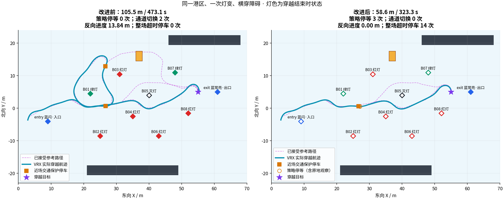
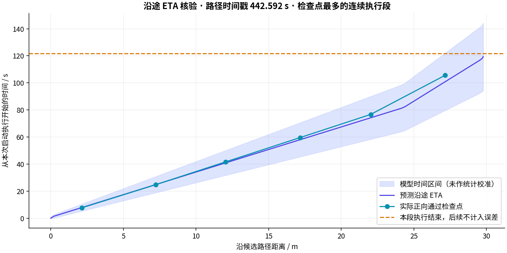

# Task 1：等待、沿途 ETA 与路线切换改进（2026-11-02）

最终版本在连续横穿、临时封路两个港区场景均完成任务，无接触碰撞。当前结论仅覆盖各一次完整冷启动；中间失败和剩余限制一并保留。

原港区横穿虽然完成任务，但先北绕、再折返，穿越航程超过 105 m。本次让规划比较沿途到达时间、有限等待与换路代价，并在真实 VRX / SITL 中处理了静止观测残留和末端侧滑问题。完整控制仍为 Nav2 → rover_bridge → MAVROS → ArduRover → VRX；导航仍使用飞控 EKF。

## 实现与参数

- 沿路线计算加速、曲率约束、末端减速和制动；采样 ≤0.4 m / 0.15 rad，保留 `0.8×ETA−1 s` 至 `1.2×ETA+1 s` 到达区间。巡航命令上限 0.3 m/s、0.4 rad/s，加速/减速 0.2 / 0.08 m/s²。
- 比较未来 90 s 行程与 LiDAR 实测交通轨迹；尝试 0–60 s 等待、步长 5 s，实际每 5–15 s 重新检查。等待期间当前位置的完整船体也参与冲突检查。
- 同目标、同灯态参考路线，平均偏离 >0.75 m 时增加 `10 + 2×偏离距离/速度上限` 秒的切换评分；参考路线计 5 s 重规划成本，至少有 10 s 评分收益才优先等待。搜索的软连续性权重为 0.2、距离上限 6 m，碰撞和比赛规则检查始终为硬约束。
- 目标停住、释放时间未知时，另算 `min(60 s, 候选评分 − 原路 ETA − 5 s − 10 s)` 的观察预算。它不承诺障碍会离开；只有整个预算期间原地停留安全才采用。累计预算从首次实际停等开始，输入超时不能续期，耗尽后重新评估绕行。
- 完整路线连续规划失败后，允许在已完成两色通过要求、同语义同向参考有效时，申请前方 3 m / 2 m / 1 m 观察点。每段仍须经当前 costmap、完整船体、比赛规则及两类交通评估批准；路径 ≤5 m、离参考通道 ≤0.75 m。观察点到达不推进比赛阶段。
- 穿越路径末端 4 m 内，通过 Nav2 `SpeedLimit` 把线/角速度上限降至 50%（0.15 m/s、0.2 rad/s），离开区域或进入绕圈阶段恢复 100%。ETA 使用同一策略。原控制到点容差 0.4 m / 0.2 rad、独立验收 0.5 m / 0.25 rad 均保留。

路线建议以 2 Hz 发布，绑定源点云时标、候选/参考路径和语义版本。它不授予运动许可；既有 0.4 s 源/接收时间保护、连续 1 s 清空、停车等待与控制租约仍生效。ETA 区间未经统计校准，成本比较是滚动启发式决策，不是全局时空最优解。

说明与命令见 [交通策略](../traffic_avoidance.md)、[运行流程](../runbook.md)。

## 最终版本与完整回归

行为提交：`1847a40fb50d663f1c52231f4ee9b89287f30132`。后续分析与报告提交不改变控制行为。飞控固定为 ArduRover V4.4.0 / `d0356316eb0fa34ed1c9f39f7b059b9ae7ba4664`。最终运行的行为文件哈希逐项核验，原始日志与源码快照保留。

| 用例 | 完整判定 | 穿越航程 / 耗时 | 通道切换 | 末端位置 / 航向误差 | 最小交通净空 |
|---|---|---|---|---|---|
| 连续横穿 171813 | 通过，0 接触 | 58.605 m / 323.3 s | 0 | 0.245 m / 0.155 rad | 6.283 m |
| 临时封路 170326 | 通过，0 接触 | 58.999 m / 406.5 s | 0 | 0.371 m / 0.044 rad | 6.197 m |

路径为 `runs/20261102_<上述时间>_task1_harbor_s1_c1_<cross或block>`，场景均为 harbor seed 1、一次灯变、无风无浪，交通船速度 0.25 m/s。block 在通道内停留 40 s；该时间只供场景驱动和独立评估，未输入导航。

同场景横穿对照使用原 034656 / 040530 / 042050 三次成功运行。旧穿越航程 105.545 / 108.170 / 106.463 m，耗时 473.1 / 487.2 / 492.0 s，几何换路均为 2 次。新版同时包含末端限速，因此时间变化不能只归因于等待评分。新结果的重复次数如实列出，不把旧版本三次成功算作新版重复验证。

相较旧版三次的均值，横穿航程减少约 45.1%，穿越耗时减少约 33.2%。新版穿越有 3 次策略停等、1 次近场让行、2 次完整规划失败，成功执行 1 次前移观察后恢复；控制器失败为零、穿越输入超时为零。出口绕圈出现 14 次输入超时停车，均在 0.108 s 内发零，保留原时效门槛。整场耗时 752.760 s；到点后 11.8 s 漂移 0.032 m。不能把穿越收益直接当作整场或无故障性能。

指标定义：航程和净空来自独立 VRX 真值；“反向进度”是沿穿越起点到目标轴的累计负位移，不代表倒车推力。几何换路只统计同灯态版本、相容的已接受完整路径之间平均偏离 >0.75 m 的变化；灯变必需的重规划和前移观察段单列。整场耗时包括入口/出口绕圈和停等。

## 封路中的实际等待与恢复

170326 全场 754.988 s，6 次策略停等，其中 1 次为释放时间未知的观察等待；另有 1 次近场交通保护让行。没有输入超时停车。两次完整规划失败后执行两段短距离观察：第一段进展超时、安全停下，第二段在 532.0 s 到达观察点，随后恢复完整任务。因此本轮包含 **2 次规划失败、1 次控制器失败及成功恢复**，不是无故障运行。

固定参考路径的共同 296 个点，在 443.38 s 地图中有 101 点经原完整船体检查受阻，在 536.924 s 的新地图中为 0；见 `observation_recovery.json` 和 `search_replay/`。未清空或衰减旧体素、未降低碰撞余量，也未按交通船真值删除障碍。

封路 491 张、横穿 512 张任务期全局地图均保留十个实体浮标。临时封路中，交通船离开检查区后，58.472 s 才观测到旧区域清空；不能把预测通道安全等同于实测地图已清空。变灯后、封路前实际接受的参考路径与停船位置的带余量船体有交叠，确认测试覆盖实际受阻通道；首次穿越计划在灯变前，单看它会误判挑战条件。

末端任务段记录 371 个稳定限速样本，前向命令最大 0.15 m/s、转速命令最大 0.2 rad/s，实际前向/横向速度峰值约 0.185 / 0.047 m/s；退出穿越后恢复 100%。命令上限与船体实际速度分别报告。到点后继续观测约 10 s，漂移 0.221 m，当前没有持续定点保持。

## ETA、故障保护与完整证据

封路恢复后的完整任务段：预测 112.897 s，实际 111.2 s，误差 −1.697 s；成功观察段预测 22.929 s，实际 20.5 s。取消或失败后没有实际到达的未来点不填成到达样本。

横穿共有 13 个实际正向通过的沿途检查点，平均绝对 ETA 误差 1.388 s，13 个都落入预设区间。检查点沿路径每 5 m 取一个、从 2 m 开始；通过路径法线、横向距离 ≤1.5 m 且航向差 ≤1.2 rad 才计到达。仅使用本次执行终止前的实际到达，不推造被取消的后续样本。该样本量不能证明 100% 普遍覆盖率。

恢复后的完整横穿任务段预测 119.402 s、实际 121.7 s，差 +2.298 s。整段实际时间以控制器成功返回为终点，含原目标容差；预测到路径端点并计制动，两者定义的细小差异也会影响误差。未来停车/输入中断不是已知的 ETA 输入。

两次起步转向中的感知进程故障测试均通过独立的零指令和船体低速判定；不代表完成比赛任务。

| 故障用例 | 发零延迟 | 低速持续确认 | 停车路程 | 新鲜输入恢复 |
|---|---|---|---|---|
| 173517 `traffic_gap` / SIGSTOP | 0.280 s | 4.664 s | 0.561 m | SIGCONT 后恢复执行 |
| 173704 `traffic_exit` / SIGTERM | 0.384 s | 4.896 s | 0.622 m | 保持停车，无进程自动重启 |

低速标准为真值平动 <0.05 m/s 且角速度 <0.05 rad/s、持续 1 s；物理帧继续推进、FCU 在线、无接触。两次注入后 10 s 内均未确认左右反馈推力 ≤1 N 持续 1 s，因此只判定命令响应和低速，不判定推进器完全归零。最后 2 s 最大反馈力均为 1.2 N；速度分别 0.0084 / 0.0092 m/s，指令均为零，见各目录 `thrust_settling_diagnostic.json`。

视频使用真实 VRX 相机，明确标注红/绿/灭灯、规划/实际路径、地图源时间、ETA、观察预算和换路代价；不是 UAV 视觉识别输出。2.5 倍播放，1920×1080 / H.264 / 5 fps。

| 证据 | 临时封路 170326 | 连续横穿 171813 |
|---|---|---|
| 完整标注 MP4 | [306.2 s](../../../runs/20261102_170326_task1_harbor_s1_c1_block/visualization/task1_annotated.mp4) | [305.4 s](../../../runs/20261102_171813_task1_harbor_s1_c1_cross/visualization/task1_annotated.mp4) |
| 穿越片段 | [164.6 s](../../../runs/20261102_170326_task1_harbor_s1_c1_block/visualization/task1_transit.mp4) | 见完整视频 |
| 轨迹、地图与末端 | [visualization/](../../../runs/20261102_170326_task1_harbor_s1_c1_block/visualization/) | [visualization/](../../../runs/20261102_171813_task1_harbor_s1_c1_cross/visualization/) |
| 完整实验 ZIP | [175,816,446 bytes](../../../runs/exports/20261102_170326_task1_harbor_s1_c1_block.zip) | [152,211,148 bytes](../../../runs/exports/20261102_171813_task1_harbor_s1_c1_cross.zip) |

ZIP 包含原始日志、参数、运行/分析源码快照、地图和视频；约 9 GB 的原始点云 rosbag 单独保留，其绝对路径、字节数和 SHA-256 位于 `export_manifest.json`。全部打包文件逐项 SHA-256 与 ZIP CRC 校验；不会覆盖旧归档。视频全程解码核验，详见每轮 `visualization/video_validation.json`。

封路 ZIP SHA-256：`791ced4bd2f62232499020ab520353416b0d41bb68386268fa2d9004510456b5`。
横穿 ZIP SHA-256：`7082f655465bf3e86d045b2f7f7d206513f21600ffd50141add0eb3b9a8a800d`。

[精简指标和证据索引](20261102_route_decisions_evidence.json) 随 Git 跟踪；其中源码哈希、故障结果、检查清单和归档校验可用于审计。`runs/` 的视频、rosbag、ZIP 是服务器本地文件，不会随 GitHub 克隆下载。

170326 与 171813 各 31 个行为文件均与最终代码一致，SITL 帧计数单调跨过 65,535，最大分别 202,250 / 202,000；rosbag 包含点云、扫描、TF、时钟、飞控里程计、速度指令、路径评估、任务上下文、运动许可和限速消息。见各目录 `route_evidence_audit.json`。

## 保留的失败与验证范围

| 中间运行 | 实际结果及作用 |
|---|---|
| 150054 / 151501 cross | 旧改进版完整通过；穿越 58.073 / 59.055 m，但有 12 / 22 次输入超时停车，第二轮另有 12 次规划失败 |
| 153116 / 154145 cross | 正常取消、未完成；定位重试计时和静止 LiDAR 体素残留，日志与传感器包保留 |
| 161010 cross | 036eced 版本通过，57.085 m / 327 s；36 次超时停车，不能算最终限速版本通过 |
| 162516 block | 目标短暂停住时过早北绕，后续持续无合法路径；取消并保留失败 |
| 164135 block | 观察预算及中间通道恢复生效，但末端侧滑停在目标旁约 0.74 m；取消，完整任务失败 |

全部目录前缀为 `20261102_`、后缀为 `_task1_harbor_s1_c1_<cross或block>`。根因、最小修复、失败图与回放见 [调试记录](../debug_log.md)。服务器较早出现过可用 32 CPU 而负载约 45–51 的情况；源时间过期仍按原门槛停车，没有通过延长期限隐藏问题。

本轮代码检查：85 项 Task1、24 项原导航、12 项仿真纯逻辑测试；5 项真实 ROS 检查；C++ 规则搜索、完整船体/连续性、交通层合并三组检查；`git diff --check`。这些与表中的真实 SITL/VRX 结果分开计数。

范围仍是已知灯位/灯态的船端仿真。尚未覆盖其他港区布局、更多种子、目标突然转向/加速、长期封路、风浪与定位降级组合或实船；没有新增 UAV 视觉、正式 RoboCommand、RTK/EKF 质量门控或持续定点保持。
