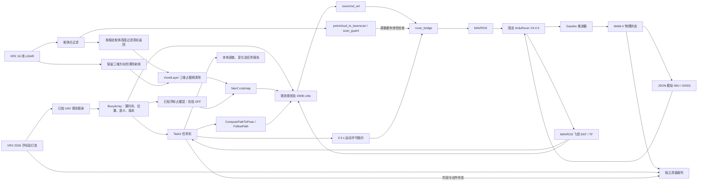

# RobotX 2026 Task 1 实施记录

依据：2026-10-23 官方手册，Task 1 第 71–74 页、评分第 114–117 页；下载与校验见 `sources.json`。

实现范围：2026 RoboBuoy、已知位置和语义灯态替身、WAM-V 船端规划、独立本地裁判。正式 UAV 感知/飞行与 RoboCommand 未实现；本地报告不能计为正式比赛得分。WAM-V 超过本届 2 m × 1 m × 1 m 参赛尺寸，结果仅代表本船模的软件验证。

规则：十个浮标；闪烁周期亮一秒/灭一秒；闪蓝入口先顺时针绕完整一圈；常蓝出口最后逆时针绕完整一圈；红在右舷、绿在左舷；正横时同侧最近浮标才计通过；OFF 仍是实体障碍。语义状态与亮灭相位独立。

比赛场景约束以用户 2026-11-01 确认为准：全场仅一次语义灯态切换，闪烁亮灭不计次数。主验收使用一次切换，零切换作为对照；历史两次切换用例保留为额外压力测试。历史两次切换失败不直接判定一次切换场景失败，一次切换结合动态障碍仍须独立验证。

控制：Nav2 → rover_bridge → MAVROS → ArduRover V4.4.0 (`d0356316eb0fa34ed1c9f39f7b059b9ae7ba4664`) → VRX。规划定位来自飞控 EKF；真值只供裁判和模拟观测。灯态改变先取消、发零、实测停车，再求解新路。停车不等于推力归零，仿真冻结不算停车。

交付阶段：模型及观测 → 规则规划及离线测试 → 闭环和切换 → 动态障碍、异常、视频与报告。失败运行保留在 runs；最终验证状态另见 validation.md。当前文档不是通过报告。

当前场景的覆盖边界：seed 1 的八个中间浮标为两排直线，同排间距 8 m、两排相距 14 m；seed 2/3 只在该布局上做小幅扰动，不能视为已经覆盖不规则比赛布局。演示视频的一次灯变固定在进入穿越阶段 20 s 后，且没有动态障碍。它证明基础流程可完成，不足以证明复杂场景中的可靠性。

下一轮场景扩展按以下顺序推进，仍保持已知浮标位置/状态替身，每场仅一次语义切换：

1. 先修复已复现的动态接触碰撞、阻挡后恢复及批次启动问题；新的场景不能掩盖现有失败。
2. 加入不规则错位、斜向通道、红绿混合分布、最近同侧浮标判定和 OFF 实体占据；同时保存固定随机种子和布局。先核实合法路径与船体净空，WAM-V 无法通过的布局不能通过缩小 footprint 使其通过。
3. 分别测试进入穿越的早期、中段和临近决策位置的一次灯变，包含需要明显改道和确实无合法路线的情况；后者单独验收安全停止，不算任务完成。
4. 让动态障碍实际与当轮参考航迹产生冲突，覆盖横穿、临时阻挡及移开后的恢复。分别记录船撞障碍和已停车船被移动障碍撞击；停车通过不能替代避碰通过。
5. 平静水面的上述场景通过后，再分别加入风、浪和定位扰动做对照。场景复杂度、控制能力及感知假设分别记录，保持无人机视觉接入在本轮范围之外。

以上为后续覆盖要求，尚未全部搭建或通过；完整结果始终以逐轮记录为准。

“已知 UAV”目前直接读取场景的浮标配置与灯态，未从相机图像识别；摄像头用于检查新模型及保存证据。Task1 不订阅船体真值作为导航定位，动态障碍轨迹也不注入规划器。独立裁判读取真实运动、接触和灯变生效时间，分别检查规则和停车。

控制器以 EKF 判断绕圈时额外要求 0.05 rad 的累计角度余量；独立裁判仍要求真值完整 2π 和回到绕圈起点附近。该余量用于吸收 EKF 与真值的小差异，不能作为降低完整绕圈标准的理由。

Task1 新候选使用三维 VoxelLayer，避免从低矮障碍上方穿过的射线在二维投影中清空整列。`pointcloud_to_laserscan` 和 `/scan` 仍保留，桥继续检查扫描有效性；原导航场景仍使用原扫描地图。全局规划与 DWB 增加完整凸船体内部占据检查。此处描述实现，是否通过动态碰撞测试以验证报告为准。

港区横穿碰撞的修复增加 [LiDAR 交通跟踪、预测代价层及候选路径检查](traffic_avoidance.md)。它使用源时刻 FCU TF，交通真值仍只用于独立评估。候选路径通过持续新鲜的交通评估后才发送给 FollowPath；受阻时允许在停车状态重规划。
