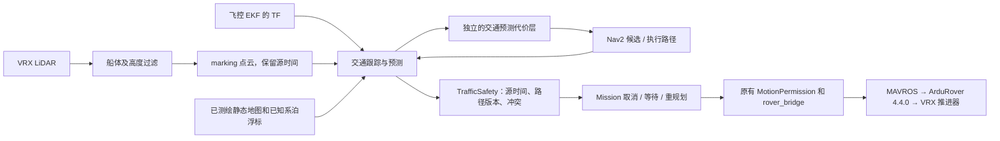

# LiDAR 交通让行保护

此适配层针对港区横穿测试暴露的碰撞：低矮交通船进入近场后，可见点云不能覆盖完整外廓，而 DWB 的当前占据检查没有目标运动预测。保留原有规则规划器、DWB 和控制链，在任务层加入提前让行与恢复规划。

## 输入与控制关系



- 节点为 `robotx_task1/traffic_guard`，输出 `/task1/traffic_safety`。不读取交通船模型名称、尺寸、真值或场景预定航线。
- 点云在**测量源时刻**通过 FCU TF 转到 map。静态地图和已知系泊浮标用于排除固定表面的可见范围变化；这些实体仍由原 costmap、KnownBuoys 和船体碰撞检查处理，不从地图删除。
- 保护节点选择队列中已有对应 FCU TF 的最新点云，丢弃被取代的旧样本；更新的点云若尚缺源时刻 TF，则继续等待。不会以最新 TF 替代源时刻 TF，也不改时间戳或放宽有效期。原始 costmap 的点云订阅不受此队列选择影响。
- 新规划先发布到 `/task1/candidate_path`，通过相应 `path_stamp` 的持续新鲜评估后才成为 `/task1/reference_path` 并发送 FollowPath。
- `/task1/traffic_costmap` 为独立的推断占据层，包含测量外廓及短时预测。专用 `TrafficLayer` 只向两张 costmap 添加致命占据；空推断不代表自由水域，不能清空原始障碍、浮标、边界或 unknown。完整新快照更新后会移除该层旧位置的占据。
- 交通冲突取消 FollowPath，通过原有任务许可让桥发零。满足停车条件后计算候选路线，比较等待原通道与采用候选的到达时间和切换代价。选等待时每 5–15 s 使用最新完整 costmap **重新规划**，不能直接执行旧路径。原路线偏好预算为 90 s；到期只取消偏好，不能绕过候选的预测冲突、近场保护或碰撞检查。语义变更使旧路线和等待意图失效。

## 参数与模型

| 项目 | 当前值 / 方法 |
|---|---|
| 观测范围 | 20 m 内建立新目标；已确认运动目标的关联外廓可使用 40 m 内实际点云续跟，避免把 LaserScan 的 20 m 截断误用到完整点云；不凭空补回波 |
| 聚类 | 0.12 m 均匀取样，0.55 m 相邻连接，至少 5 个采样点 |
| 速度估计 | 最近 3 s 的测量边界拟合，至少 1.8 s / 6 帧；检查两侧边界运动一致性 |
| 运动确认 | 估计速度 ≥ 0.10 m/s、测量位移 ≥ 0.25 m；拟合残差及最大速度检查 |
| 外廓维护 | 按测量外廓重叠关联分裂回波；部分可见时保留已观测尺寸的所有可能位置范围，以新表面约束位置，不无限外推旧角点；稳定部分表面也可更新各轴速度 |
| 预测 | 20 s 常速度；对本船未来可达路径段的完整船体扫掠区域做保守空间冲突检查 |
| 本船速度界 | 从该次 Nav2 `max_vel_x` 读取，当前 0.3 m/s，因此路径前视 6 m |
| 目标外扩 | 0.6 m 间距 + 0.15 m 测量余量 + 0.04 m/s × 预测秒数；丢失后额外按 0.2 m/s 增大 |
| 近场丢失 | 超过 2 s 不再信任单独的外推位置，联合保留末次与预测外廓；不因时间到期宣告清空 |
| 范围外目标 | 失去观测超过 2 s，且末次到预测外廓整个区域都在本船 22 m 外，才从局部跟踪器退出 |
| 评估有效期 | 源时间及墙钟接收时间均不超过 0.4 s；进程丢失、缺 TF 或旧消息不能放行。处理时仍丢弃年龄 > 0.35 s 的点云 |
| 预测层更新 | 5 Hz，使用与保护一致的外廓与预测余量；保留点云源时间戳 |
| 规划净空储备 | 全局 `footprint_padding=1.0 m`，局部仍为 `0.5 m`；额外 0.5 m 对应实测约 0.33 m 停车路程、约 0.11 m 栅格尺度差和剩余跟踪余量，不改变物理船体或独立碰撞判定 |
| 规则搜索预算 | `Task1.search_time_limit=10 s`；复杂绕行记录在原 3 s 内不能完成，同图同约束的离线搜索约 4.48 s 得到合法路线。预算只影响计算，规划时仍禁止运动，新候选另行检查 |
| 让行等待 | `traffic_yield_wait=90 s` 为旧路线偏好预算；实际按到达时间和切换代价选择，5–15 s 后重新检查 |
| 恢复 | 原有 1.5 s 船体低速持续条件；相应路径的新鲜“可行”评估连续至少 1 s。等待后按最新地图规划并检查新候选；受阻重规划间隔至少 5 s |

这是滚动评估的让行和重规划策略，不保证全局时间最优。预测单独标为推断代价层，没有修改实测点云、三维清除射线或传感器时间戳。船体停止、推力归零、零指令分别用记录验证。0.4 s 有效期加 10 Hz 任务检查与 20 Hz 桥转发，目标仍为 ≤ 0.6 s 的零指令预算，必须用故障注入实测。全过程仍使用固定 ArduRover V4.4.0 `d0356316eb0fa34ed1c9f39f7b059b9ae7ba4664`。

## 等待、沿途到达时间与路径切换

`route_policy.py` 仅使用候选/已接受路线、飞控 EKF 位姿和 LiDAR 实测交通轨迹。没有场景预定速度、终点或停船时刻输入。它在 `TrafficSafety` 发布后以 2 Hz 输出独立的 `/task1/route_assessment`；该建议不能授权运动。穿越阶段的新候选必须取得源时间和接收时间均不超过 1 s、语义版本/候选/参考路线标识均一致的评估，且仍通过原 0.4 s 近场保护和连续 1 s 清空要求。

1. **沿途 ETA**：按当前方向裁剪剩余路线，位置采样间隔不超过 0.4 m、方向间隔不超过 0.15 rad。使用本次 Nav2 速度、转速、加速和制动上限，前向计算加速、后向计算末端制动，曲率限制转弯速度。穿越阶段距当前路径目标 4 m 内，任务通过 Nav2 `SpeedLimit` 将 DWB 速度上限按 50% 缩放（线速度 0.15 m/s、转速 0.2 rad/s）；离开范围或切换到绕圈阶段恢复 100%。到达模型采用同一距离和比例；短段同时考虑三角形与梯形速度曲线。每一点保留到达区间 `0.8×ETA−1 s` 至 `1.2×ETA+1 s`，而非把整条路径看成同时占据。
2. **等待与绕行**：评估未来 90 s 行程内的完整船体外廓与交通目标到达区间；尝试 0–60 s 等待，步长 5 s。等待期间本船当前位置持续占用，也参与冲突检查；等待不会缩短被检查的行程范围。目标未来可能停车只增加 30 s 风险代价，不当作已知的未来真值。
3. **切换代价**：候选与旧路线平均偏离超过 0.75 m 时，增加 `10 s + 2×平均偏离距离/速度上限`。参考路线还计入 5 s 重规划成本；收益至少超过 10 s 才优先等待。旧路线须同终点、同语义版本，且当前位姿接近同向路径段；过期或不相容的参考不参与比较。
   交通目标停车、原通道在 60 s 内没有清空预测时，另算有限的观察预算：`min(60 s, 候选总评分 − 原路线 ETA − 5 s − 10 s)`，不足 5 s 不采用。只有整个预算期间静止船体的预测占用安全才提出此选项；每次最多等 15 s 后重新观察与规划。它不是“障碍会离开”的预测，也不批准旧路径运动。累计等待从首次实际停等开始，数据超时不会重置；预算耗尽后可以接受经过全部检查的候选绕行。已知冲突不会因预算到期而被放行。
4. **搜索连续性**：规则规划器在碰撞、赛事规则硬检查后，为偏离已接受路线增加软代价（`continuity_weight=0.2`，距离上限 6 m）。该项不修改地图，不降低净空，也不强制跟随已受阻的旧路线。
5. **停等后重新观察**：16 线 LiDAR 的射线不一定能在静止位置重新扫过交通船留下的全部体素。完整目标连续两次规划失败后，若已完成红/绿两色通过要求，且存在当前语义下的同向完整参考路线，可向同一规划器申请沿该通道前方 3 m 的观察目标；失败时尝试 2 m、1 m。候选仍须通过当前完整 costmap、船体余量、比赛规则和两类交通评估；另外限制路径总长 ≤5 m、离原通道 ≤0.75 m，拒绝借此进行长绕行。到点只结束该小段，任务目标和阶段不变；船停止后根据真实新点云重新规划。灯变废弃观察意图。没有清空、衰减或按目标真值删除旧体素。

这些 ETA 是依据运动上限的预测，尚未辨识船体水动力、DWB 减速、风浪或定位误差；20% 时间区间也不是统计校准过的置信区间。观察预算衡量短暂等待的可接受代价，不是障碍释放时间估计。长期遮挡和持续封路可能维持停车直至任务超时。不能把“选择等待”或离线回放的收益当作真实闭环通过。

初版 12 s / 3.6 m 前视虽阻止碰撞，但停止位置太靠近后续受阻路段。加长至 20 s / 6 m 以保留转向与观测空间：当前最低标记高度 0.25 m、LiDAR 安装高 1.8 m、最低仰角 −15°，对应低表面近场盲区约 5.8 m；实际船体升沉和射线离散还会影响可见性。该距离说明为何需要提前等待，不构成清除任何占据的依据。保留体素占据和原碰撞门槛，最终效果以完整闭环为准。

短时常速度、稳定测量坐标和局部观测范围是此模型的边界。低于确认阈值的运动、目标突然转向/加速、长期遮挡以及定位质量下降需要分别验证；本实现不新增 RTK/EKF 质量门控，也不等同于实船避碰保证。长期近场丢失或持续封路可能一直停等，最后由现有任务超时退出。

## 复现与证据

从仓库根目录：

```bash
source scripts/env.sh
colcon build --symlink-install --base-paths src --packages-select robotx_task1_interfaces robotx_task1 robotx_task1_nav
python3 scripts/run_task1_suite.py --course harbor --group dynamic --seed 1 --changes 1 --dynamic cross --record-maps --record-sensors
```

运行结束后，使用本轮实际目录：

```bash
python3 scripts/analyze_task1_traffic.py runs/<本轮目录>
python3 scripts/analyze_route_efficiency.py runs/<旧目录> runs/<新目录> --output runs/<新目录>/route_efficiency.json
python3 scripts/annotate_task1.py runs/<本轮目录>
```

`traffic_guard.jsonl` 保存点云源时间、处理时间、路径版本、每个测量目标的外廓/速度、合并和退出、预测冲突。`task1_mission.jsonl` 保存让行、取消、重规划与恢复。`traffic_avoidance.json` 将这些事件关联到实际指令、推进器及真值运动；真值只用于这个离线评估。完整视频继续显示明确的红绿灯态、规划路径、实际轨迹和地图，并额外显示交通预测状态。

`route_decisions.jsonl` 另存候选/参考 ETA、建议等待、切换代价、评估耗时，以及每条新路径首次评估的完整沿途到达区间。`replay_route_policy.py` 可对旧实验只读评估决策差异；`analyze_route_efficiency.py` 用独立真值计算总航程、穿越时间和朝目标反方向的累计位移，并区分预测、实际执行与取消。比较输出写入新目录，不改动已归档的历史实验。

冻结或退出保护进程的测试分别为：

```bash
python3 scripts/run_task1_suite.py --course harbor --fault traffic_gap --no-video
python3 scripts/run_task1_suite.py --course harbor --fault traffic_exit --no-video
```

这些异常测试必须保持飞控和物理仿真运行；其通过只表示按预期停车，与完整任务通过分开记录。

`replay_task1_traffic.py` 可以只读回放既有传感器记录，使用记录的 FCU TF、静态地图和已知浮标观测。它不启动控制，也不能代替闭环验收。

最终当前行为的横穿、封路、感知进程故障和 ETA 实测见 [等待与路线选择实验](experiments/20261102_route_decisions.md)；旧版碰撞修复三次成功不计作本版重复回归。
