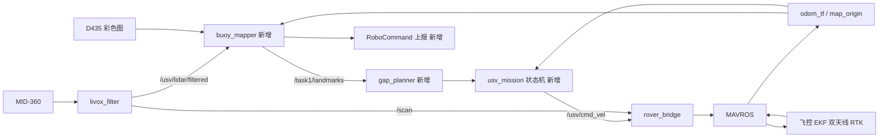
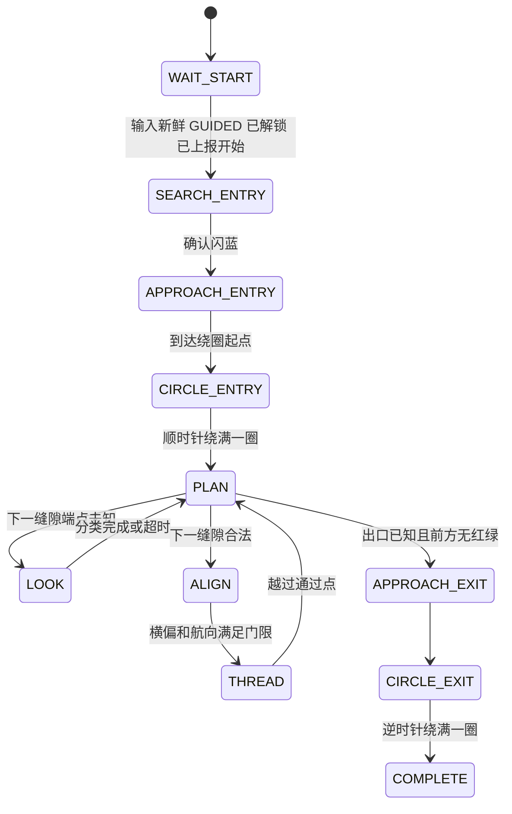

# RobotX 2026 Task 1（Safe Passage）纯 USV 方案交接文档

日期：2026-11-10
对应仓库：`Ericzhaoforu/rx_simu`，分支 `codex/orin-deployment`，阅读时的提交 `bdf357fc4d234617d8f8ea05e953b9ae46da03e7`
运行目标：USV 上的 Jetson Orin，Ubuntu 22.04，ROS 2 Humble

> **本文档的可信度分级**
> - **[已核对]**：直接读自仓库源码或官方手册。
> - **[现场]**：队员 2026-11-10 在赛场目测或口述，未经测量。
> - **[估算]**：推算值，必须用实测数据确认。
> - **[待定]**：尚未决定或缺信息。
>
> 本文档的全部内容来自阅读代码和讨论，**没有运行过任何代码，也没有任何实船验证**。

---

## 0. 给 Claude Code 的使用说明

把本文件放进仓库（建议 `docs/task1/usv_only_plan.md`），开始工作前让 Claude Code 先读它，再读仓库根目录的 `AGENTS.md`（学长定的项目约定，仍然有效）。可以直接用下面这段作为起始提示：

```text
先阅读 docs/task1/usv_only_plan.md 和 AGENTS.md。
我们的 UAV 没有通过验证，Task 1 只能由 USV 自己完成 Core 级。
按文档第 8 节的实施顺序，从第 1 步开始。
不要修改 mission.py、observer.py、traffic_guard.py 和 robotx_task1_nav，
新功能写成 robotx_task1 包里的新节点。
每一步先写离线测试，再告诉我在 Orin 上怎么验证。
```

---

## 1. 背景与约束

- UAV 未通过 validation，现在只有 USV。目标是 Task 1 和 Task 3 的 **Core 级**。本文只覆盖 Task 1。
- 船体约 1.2 m × 0.7 m（规则上限 2 m × 1 m × 1 m，60 kg）。[已核对：手册与仓库 `AGENTS.md`]
- 传感器：
  - Livox MID-360，离水面约 0.5 m [现场]
  - RealSense D435，固定朝正前方，用于 Task 1
  - OAK-D Lite，用于 Task 3 的泊位和喷水窗口识别
  - 双天线 RTK [现场]
- 飞控固定为 ArduRover V4.4.0（提交 `d0356316`）。定位来自飞控 EKF，经 MAVROS 输出。[已核对]
- 控制链固定为 `速度指令 → rover_bridge → MAVROS → ArduRover → 推进器`，不并行启动其他控制器。[已核对]

---

## 2. Task 1 Core 级规则摘要 [已核对：官方手册 2026-10-23 版]

- 场内共 10 个浮标，每个顶部有 LED 灯。Core 级红绿灯从侧面可见，UAV 为可选。
- 灯在队伍向 RoboCommand 报告开始尝试后，以**随机配置**点亮，一次尝试内保持不变。
- 闪烁周期为亮 1 秒、灭 1 秒。

| 灯态 | 含义 |
|---|---|
| 闪蓝 | 入口。进入前须**顺时针**完整绕一圈 |
| 常蓝 | 出口。完成穿越后须**逆时针**完整绕一圈 |
| 闪红 | 须从船的**右舷**一侧通过（浮标在船右边） |
| 闪绿 | 须从船的**左舷**一侧通过（浮标在船左边） |
| 灭（黑） | 普通障碍，两侧均可 |

- 判定方式：浮标位于船正横、且是该侧最近的浮标时，记为"通过"。

### Core 级计分（满分 325）

| 项目 | 分值 |
|---|---|
| 心跳 | 25 |
| 正确上报入口 | 10 |
| 正确上报出口 | 10 |
| 上报闪绿浮标（最多 4 个，每个 10） | 40 |
| 上报闪红浮标（最多 4 个，每个 10） | 40 |
| 顺时针绕入口 | 25 |
| 逆时针绕出口 | 25 |
| 只从左舷通过绿浮标 | 25 |
| 只从右舷通过红浮标 | 25 |
| 全部完成奖励 | 100 |
| 碰撞任何场地物体 | 每次 −10 |

**结论：上报类共 125 分，只需要感知和 RoboCommand，不需要规划，应最先落地。**

---

## 3. 场地信息

### 3.1 官方示意图（"Example Task 1 Layout and USV Path"）

- 10 个浮标**不规则散布**，不是成对的门，也不是两排直线。
- 入口（闪蓝）和出口（常蓝）在对角位置。
- 示例配置：2 红、2 绿、4 灭、2 蓝。灭灯浮标数量不少。
- 示例路径是 S 形曲线，有一段贴着浮标群**外侧**行驶，说明从外侧绕行在示例中是被接受的。
- 该图是示意，不按比例，页面正文没有任何尺寸。

### 3.2 现场观察 [现场]

- 相邻浮标之间可通过的净宽（内侧边到边）约 **1.5–2 m**，船刚好能过。
- 相邻两排之间约 **4–6 m**。
- 整个任务水域比较小。

### 3.3 仍缺的信息 [待定]

- 实际布局照片或草图、入口相对出发点的位置、水域总尺寸。
- 浮标实际高度和直径。
- 单次尝试是否有时间限制。

---

## 4. 现有仓库评估

### 4.1 可以直接复用 [已核对]

| 路径 | 作用 |
|---|---|
| `src/usv_nav2`（`odom_tf`、`rover_bridge`、`navigation.launch.py`） | 飞控定位转 TF、控制门控、Nav2 启动 |
| `src/usv_sim/usv_sim/livox_filter.py` | 真实 MID-360 点云去船体、去畸变，输出 `/usv/lidar/filtered` 和 `/scan` |
| `src/usv_sim/usv_sim/map_origin.py` | 地图原点与飞控 EKF 原点配准 |
| `src/robotx_task1/robotx_task1/core.py` | `passage_events`（正横规则判定）、`CircleTracker`（绕圈完成判定），纯 Python、无 ROS 依赖 |
| `src/robotx_task1_interfaces` | `Buoy` / `BuoyArray` 等消息 |
| `docs/hardware_deployment.md` | 实船部署、启动顺序和分阶段水试流程 |

### 4.2 因为没有 UAV 而不再成立的部分

- **Advanced 和 Disruptive 级**全部放弃。它们依赖只有 UAV 能看到的顶部灯和 UAV 的实时转发。
- **"先全知、后规划"的前提**。原设计假定 UAV 先扫一遍，给出 10 个浮标的完整语义地图。船自己只能边走边发现。
- **`observer.py`** 是读取 Gazebo 场景状态的替身，实船上没有数据来源。
- **语义灯态中途切换的处理**（停车、重规划）是为 Disruptive 级准备的，Core 级一次尝试内灯态不变。但自己的分类结果被修正时，仍需要重规划。

### 4.3 原设计与现状不符的地方

1. **硬性要求完整快照**。`mission.py` 的 `on_observation`、`plugins.cpp` 的 `valid()` 与 `read()`、`traffic_guard.py` 都要求：恰好 10 个浮标、恰好 1 个入口和 1 个出口、`survey_complete=true`、0.35–0.5 s 内新鲜，否则船不动。
2. **尺度假设差一个量级**。仿真用 WAM-V（碰撞外廓约 5.4 m × 2.5 m）、浮标同排间距 8 m、两排相距 14 m、绕圈半径 6 m、膨胀半径 4.5 m。现场净宽只有 1.5–2 m。
3. **规划格点太粗**。规则 A* 使用 0.4 m 状态格、0.6 m 运动边、1 m 纵向规则余量，对 1.5–2 m 的缝隙过粗。
4. **航向轴写死**。`mission.py` 的 `select_target` 把接近入口的目标设为 `entry.x - radius`、航向 π/2，等于假定场地沿地图 +x 方向展开。
5. **没有任何相机识别代码**。仓库里的图像处理只用于仿真取证。
6. **`Buoy.msg` 没有"未知"状态**，只有 0–4 五种。
7. **RoboCommand 未接入**。任务机里的上报都是 `report_sink='local_only'`。
8. **实船流程不包含 Task1**。`build_hardware.sh` 只编译 `robotx_task1_interfaces`、`usv_nav2`、`usv_sim`；`hardware_deployment.md` 明确只部署普通 Navfn + DWB。C++ 规划器还依赖 OMPL。
9. **任务机依赖交通评估租约**。`mission.py` 要求 `traffic_guard` 的评估新鲜才允许运动，这套动态避让在实船和 MID-360 上未验证，Core 级也不需要。
10. **实船导航参数与窄缝不兼容**。现有初值为膨胀 1.0 m、船体 padding 0.2 m、到点容差 0.5 m / 0.25 rad、速度上限 0.2 m/s。
11. **costmap 清除问题**。文档写明无回波的栅格保持未知、不会自动清除，开阔水面上的障碍残留是已记录的缺口。
12. **仿真验证本身不完整**。`docs/task1/validation.md` 的比赛主验收为 2 项通过、4 项接触碰撞、3 项启动失败；港区场景 4 项通过。

---

## 5. 最终技术方案

### 5.1 总体原则

- **不做 SLAM 或 LIVO**。开阔水面缺少几何和纹理特征。定位继续用双天线 RTK + 飞控 EKF。
- "建图"指的是**浮标语义地图**：最多 10 个路标，每个有位置和灯态。
- **雷达给位置和身份，相机只给颜色**。
- 规划是增量式的：任何路标更新都触发重新搜索。
- 核心不变量：**颜色未知的浮标，不允许驶到它的正横位置。**
- 少改学长的文件，新功能写成新节点。

### 5.2 数据流



### 5.3 浮标建图节点 `buoy_mapper`

**雷达部分**

1. 订阅 `/usv/lidar/filtered`，用 TF 转到 `map` 系，累积约 0.5 s。
2. 聚类，容差 0.3–0.4 m。按尺寸筛选（约 0.2–0.8 m），并要求在场地边界多边形内。
3. 与已有路标按最近邻关联，门限约 **0.5 m**。不能更大，否则相邻浮标会被合并。
4. 路标需在最近若干个窗口中多次出现才确认。总数上限 10。
5. 位置持续更新，**近距离观测权重更高**。

**相机部分**

1. 只用 D435 彩色图，不用其深度。固定低曝光和白平衡，避免 LED 过曝成白色。
2. 把每个路标的三维位置（加上灯的高度偏移）投影到图像，取小 ROI，大小随距离缩放。
3. 两个路标的 ROI 在图像中重叠时（夹角小于约 2–3°），这一帧两个都不判。
4. 只对距离小于"可靠识色距离"的路标分类。该距离须实测 [待定]。
5. 雷达尚未建出路标的远处亮点不用于分类，只作为方向提示。

**灯态判定**

| 状态 | 判据（初值） |
|---|---|
| 闪红 / 闪绿 | 在亮相位稳定看到对应色相，约 2 s |
| 闪蓝 vs 常蓝 | 需观察至少两个周期，约 4 s，看是否有亮灭交替 |
| 灭 | 在可靠识色距离内连续约 3 s 没有亮灯 |
| 未知 | 以上都不满足时保持未知 |

分类结果锁存，之后看不见也保留。

**输出**

- 话题 `/task1/landmarks`，类型沿用 `BuoyArray`，`Buoy.msg` 增加 `UNKNOWN=5`。
- 10 Hz 发布，时间戳使用**最近一次实际处理的传感器帧时间**。传感器停了，数据自然过期，船会停下。不要给旧数据打新时间戳。

**外参**

- 浮标在图像里会挤得很近，卷尺量的雷达到相机外参不够。需要把雷达聚类投到图像上，微调到重合。

### 5.4 缝隙规划器 `gap_planner`

1. 对所有路标做 Delaunay 三角剖分（`scipy.spatial.Delaunay`）。在浮标群包围盒外约 3 m 处加一圈虚拟点，状态视为"灭"，用来表示从外侧绕行。
2. 每条边是一个候选缝隙。沿某方向穿过边 AB 时，A 在左舷、B 在右舷。
3. 穿越合法的条件：
   - A 不是红，B 不是绿；
   - 净宽（中心距减去两个浮标半径）不小于约 1.2 m（船宽 0.7 m 加每侧 0.25 m）。
4. 蓝色浮标和虚拟点在侧向规则上按"灭"处理。
5. 以三角形为节点做图搜索，从入口附近到出口附近，代价为缝隙中点之间的距离。
6. 端点为"未知"的边先乐观地视为可过，加一个代价惩罚，但**穿越前必须先 LOOK**。
7. 每个缝隙输出三个航点：缝隙法线上的对准点（缝隙前约 2 m）、缝隙中点、通过点（缝隙后约 1 m）。
8. 最终航点序列用 `core.passage_events` 预检。若出现错侧事件，或会经过未知浮标的正横，则拒绝该路径并重搜。

出口尚未发现时，目标取"浮标群中离入口最远的一侧"，并优先靠近未知路标。

### 5.5 任务状态机 `usv_mission`



| 状态 | 做什么 | 退出条件 |
|---|---|---|
| WAIT_START | 检查 EKF、RTK、雷达、相机、飞控状态；发心跳；报告开始尝试 | 全部就绪 |
| SEARCH_ENTRY | 原地慢转或朝预设方向低速前进，找闪蓝 | 闪蓝路标确认 |
| APPROACH_ENTRY | 驶到入口浮标绕圈半径处 | 到点 |
| CIRCLE_ENTRY | 顺时针绕圈；船头扫过 360°，顺便分类并上报 | `CircleTracker` 完成 |
| PLAN | 调用缝隙规划器，取下一个缝隙 | 得到下一步 |
| LOOK | 停船，原地转向对准未知浮标并驻留 | 分类完成；超时则前移一点重试 |
| ALIGN | 驶到对准点，船头对正缝隙法线 | 横偏 < 0.15 m 且航向误差 < 5° |
| THREAD | 低速沿中线直穿 | 越过通过点，标记两侧路标已通过并上报 |
| APPROACH_EXIT | 驶到出口浮标绕圈半径处 | 到点 |
| CIRCLE_EXIT | 逆时针绕圈 | `CircleTracker` 完成 |
| COMPLETE | 发零速，上报完成 | — |

**全局转移**

- 任一输入过期（EKF、雷达、路标、飞控状态）→ **HOLD**：发零速，恢复后回到 PLAN。
- 飞控离开 GUIDED 或人工接管 → **ABORT**。
- 总超时 → **ABORT**。

### 5.6 运动控制

**场内（本报告新增建议，未在讨论中确认）**：浮标群内部建议不用 Nav2 的 DWB，而用一个简单的"原地转向 + 直线段跟踪"控制器走完所有航点，另加一个雷达安全停车框。理由是现有 DWB 参数和膨胀设置在 1.5–2 m 缝隙里很难调通。Nav2 可保留用于场外的粗移动。

- 直线段跟踪：角速度由横向偏差和航向误差的比例项合成，并限幅；线速度 0.2–0.3 m/s。
- 指令发布到 `/usv/cmd_vel`，仍经 `rover_bridge` 的全部门控。
- **同一时刻只能有一个速度指令发布者**。自己的控制器接管前，先取消 Nav2 的动作。
- `rover_bridge` 保持 `require_task_permission:=false`，无需改它的代码。它仍要求 `/scan` 在 0.5 s 内新鲜。

**穿缝隙（THREAD）**

- 雷达在约 2 m 外把缝隙中线定下来，之后冻结，最后一段靠 RTK 位姿保持直线。
- 原因：MID-360 向下视场只有约 7°。雷达高 0.5 m 时，粗算 2.4 m 以内只看得到浮标上半截，穿缝隙时两侧浮标基本掉出视野。[估算，取决于浮标实际高度和船的俯仰]
- 建议在 RTK 不是固定解时不进入 THREAD。

**绕圈**

- 半径从浮标中心算约 1.2–1.5 m [估算]，需按蓝色浮标周围实际空间确定。
- 沿圆周每 45° 一个航点。入口顺时针，出口逆时针。
- `CircleTracker` 默认半径 6 m，使用时必须传入实际半径。

### 5.7 双天线 RTK 的意义

- 路标地图位置 = 船位置 + 航向 × 雷达测量。航向偏 5°，6 m 外的浮标会错位约 0.5 m，足以吃掉全部余量。
- 双天线航向精度通常在零点几度，6 m 处的误差只有几厘米。[估算]
- **必须确认**飞控 EKF 确实使用了 GPS 航向，而不是磁罗盘，并在运行时监视 RTK 解状态。[待定]

### 5.8 RoboCommand 上报

- 需要：心跳、开始尝试的报告、SafePassageReport（入口位置、出口位置、已检测浮标的状态）。发现新浮标或状态变化时要更新上报。[已核对：手册的任务描述]
- **具体消息格式和字段单位未查到**，实现前须对照手册的通信章节，不要凭猜测实现。[待定]

---

## 6. 文件改动清单

| 文件 | 动作 |
|---|---|
| `src/robotx_task1_interfaces/msg/Buoy.msg` | 增加 `UNKNOWN=5` |
| `src/robotx_task1/robotx_task1/buoy_mapper.py` | **新增** |
| `src/robotx_task1/robotx_task1/gap_planner.py` | **新增**，纯 Python、无 ROS 依赖，便于单元测试 |
| `src/robotx_task1/robotx_task1/usv_mission.py` | **新增** |
| `src/robotx_task1/robotx_task1/robocommand.py` | **新增** |
| `src/robotx_task1/test/` | 为规划器和灯态判定加单元测试 |
| `src/robotx_task1/setup.py` | 为新节点加 `console_scripts` 入口 |
| `scripts/build_hardware.sh` | 构建与 rosdep 检查中加入 `robotx_task1` |
| `scripts/prepare_hardware.py` | 按小船和窄缝重调膨胀、padding、速度、容差 |
| `config/real/boat.env.example` | 增加相机 frame 与外参、绕圈半径等变量 |

**不修改、也不启动**：`mission.py`、`observer.py`、`traffic_guard.py`、`route_policy.py`、`src/robotx_task1_nav`（C++，无需编译）。

**Orin 上需另行安装**：RealSense 的 ROS 2 驱动，并补一条相机安装 TF。话题名以实际驱动版本为准。

---

## 7. 参数初值（全部待实测调整）

| 参数 | 初值 |
|---|---|
| 点云累积时间 | 0.5 s |
| 聚类容差 | 0.3–0.4 m |
| 路标关联门限 | 0.5 m |
| 最小净宽 | 1.2 m |
| 对准点距离 | 缝隙前 2 m |
| 通过点距离 | 缝隙后 1 m |
| 对准门限 | 横偏 0.15 m，航向 5° |
| 穿缝速度 | 0.2–0.3 m/s |
| 绕圈半径 | 1.2–1.5 m |
| 红绿判定时间 | 约 2 s |
| 蓝色与灭灯判定时间 | 3–4 s |
| 可靠识色距离 | **待实测** |
| `USV_MARK_MIN_Z` / `MAX_Z` | 须覆盖浮标本体和灯头，看真实点云后定 |

---

## 8. 实施顺序与退路

1. **录 bag**：`/livox/lidar`、D435 彩色图与相机内参、`/usv/odom`、`/tf`、`/tf_static`、`/mavros/state`。对着真实浮标，测出两个数：雷达多远能稳定打到浮标；相机白天多远能分清颜色。
2. **`gap_planner` 与单元测试**：用官方示意图的布局（2 红、2 绿、4 灭、2 蓝）做测试场景，确认输出路径与示例走向一致，并通过 `passage_events` 预检。
3. **`buoy_mapper`**：用 bag 离线调通，先雷达路标，再相机灯态。
4. **RoboCommand**：心跳和 SafePassageReport。做到这一步就能拿到上报分。
5. **绕入口**：实船验证入口识别、接近和顺时针绕圈。
6. **穿越**：ALIGN 与 THREAD，先在单个缝隙上验证，再连成完整流程。
7. **绕出口**并上报完成。

**退路分级**

| 完成到 | 大致能拿到 |
|---|---|
| 第 4 步 | 心跳与全部上报，最多 125 分 |
| 第 5 步 | 再加入口绕圈 25 分 |
| 第 7 步且无错侧、无碰撞 | 满分 325 |

每一步遵守仓库既有约定：控制默认关闭；先预览再启用；零指令、推进器归零、船体停止分别验证；失败如实保留记录。

---

## 9. 待确认事项汇总

- [ ] 白天可靠识色距离、雷达有效探测距离（第 8 节第 1 步）
- [ ] 实际布局、浮标尺寸、水域大小
- [ ] 飞控 EKF 是否使用双天线航向；运行时 RTK 解状态如何获取
- [ ] 雷达到相机外参标定
- [ ] RoboCommand 消息格式
- [ ] 向裁判确认：从浮标群外侧绕行是否计入错侧通过；单次尝试时限
- [ ] 场内自写控制器 vs Nav2 DWB（5.6 节的建议需要团队决定）
- [ ] OAK-D Lite 是否在 Task 1 兼作第二个彩色相机（会影响 Task 3 的对准，未决定）

---

## 10. 讨论中被否决或更正的想法

| 想法 | 结论 | 原因 |
|---|---|---|
| 用 LIVO / SLAM 建图定位 | 否决 | 水面特征不足；已有 RTK |
| 船先沿外圈侦察一遍，再用学长的全知规划器 | 否决 | 相机固定朝前，沿边界走时看不到场内；外圈还可能被判错侧 |
| 在 costmap 里放"虚拟墙"强制通过侧 | 否决 | 无回波栅格不清除，墙撤掉后会残留 |
| 按"成对的门"写状态机 | 更正 | 官方图是不规则散布，改为缝隙搜索 |
| 路标关联门限 1.5 m | 更正为 0.5 m | 现场净宽只有 1.5–2 m |
| 通过偏移 2 m、绕圈半径 2.5–3 m | 更正 | 同上；航点改为缝隙中点，半径改为 1.2–1.5 m |
| 改造 C++ 规则规划器接受部分信息 | 暂不做 | 需改三处门控并重新验证，格点对窄缝过粗，时间风险大 |

---

## 11. Task 3 备忘（不在本文范围）

Core 级满分 350：心跳 25；停靠任意泊位 50；停靠绿色指示泊位再加 100；停靠上报 25；向红灯窗口喷水直到变绿 150。只需要水面船。

---

## 参考

- RobotX 2026 Team Handbook（2026-10-23 版）：https://robonation.org/app/uploads/sites/2/2026/10/RobotX-2026_Team-Handbook-20261023.pdf
- Task 1 Safe Passage：https://robonation.gitbook.io/robotx-2026-team-handbook/section-3-autonomy-challenge/3.3-mission-task-descriptions/3.3.2-mission-task-1-safe-passage
- Task 3 Coordinated Logistics：https://robonation.gitbook.io/robotx-2026-team-handbook/section-3-autonomy-challenge/3.3-mission-task-descriptions/3.3.4-mission-task-3-coordinated-logistics
- 仓库：https://github.com/Ericzhaoforu/rx_simu （分支 `codex/orin-deployment`）
