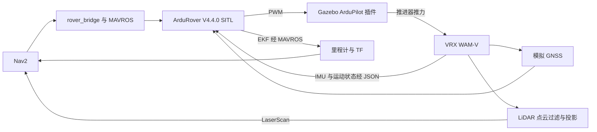

# VRX 与 ArduRover V4.4.0 导航验证计划

目标是让现有 Nav2 导航模块通过 MAVROS 和指定版本 ArduRover 控制 VRX 中的 WAM-V，验证定位、规划、障碍观测、控制及异常响应。VRX 提供船体、水动力、风浪和障碍场景，能够验证水面运动对闭环的影响；真实程度仍取决于船体与传感器参数的校准。

本轮先使用现成 WAM-V，之后再适配 1.2 m × 0.7 m 双推进器实船。RTK/EKF 降级测试先验证当前实现并报告缺口，暂不新增定位质量门控。

2026-11-04 增加用户确认的原生 LOITER 独立实验和可选 MID-360 仿真，见 [运行说明](loiter_mid360.md) 与 [实际记录](experiments/20261104_loiter_mid360.md)。当前已测试原生模式交接、风中保持以及新雷达的接口和单目标导航；Task1 自动 LOITER 等待、MID-360 整场避障和实船验证仍待完成，旧雷达结论不自动沿用。

## 1. 版本与架构

| 组件 | 约束 |
|---|---|
| ArduRover | V4.4.0，严格固定 `d0356316eb0fa34ed1c9f39f7b059b9ae7ba4664` 及子模块 |
| ROS / Nav2 | 服务器现有 Humble / Nav2 1.1.20 |
| Gazebo / VRX | Garden 7.9.0，复用现有 VRX WAM-V 资产，在本仓库建立独立适配与场景 |
| Gazebo ArduPilot 插件 | 官方提交 `80dc9664dda7efd6c5d1a71a79198d1d6b708c0e`，另存 4.4.0 兼容补丁，已构建 |
| MAVROS | 实际使用 2.16.0，用户目录解包安装，版本与校验值见依赖锁 |

控制路径只有一条，既有 NMPC/MINCO 控制器不参与本次场景。Nav2 不直接消费 Gazebo 真值位姿；真值用于模拟飞控传感器和独立评估。船体运动由 VRX 物理引擎产生，SITL 使用外部 JSON 物理接口。

仓库目录、开发约定和基础测试见 [README](../README.md) 与 [AGENTS.md](../AGENTS.md)，服务器调查证据见 [环境基线](environment_baseline.md)。

## 2. 自主排障与代码管理

- 遇到问题先自主 debug：复现并保存日志，区分环境、协议、时钟/坐标、传感器、控制与物理模型问题，定位根因，做最小修复，再回归相关链路。
- 不因普通安装、编译或运行错误立即停下来询问用户。确实需要用户补充无法自行获取的信息或作出需求取舍时，带上排查证据和具体问题；继续推进独立工作。
- 每个阶段留下运行命令、版本、参数、结果和失败原因。不能把纯逻辑测试通过写成闭环通过，也不能绕过门控或更换目标固件来掩盖错误。
- 本仓库管理导航源码、仿真适配、兼容补丁、地图、测试及报告；按可审查的小改动提交。第三方源码和大型运行记录放在 Git 忽略目录，保留引用、提交号和必要校验值。

## 3. 分阶段实施

### A. 固定依赖并建立独立 VRX 场景

1. 在独立目录检出指定 ArduRover 提交并构建 SITL，记录启动日志和构建信息，保留既有硬件工程。
2. 补齐 MAVROS、点云转扫描、GeographicLib 数据及插件构建依赖。显式选择 Garden，检查桥和插件动态库版本。
3. 新建导航测试世界，复用水面、WAM-V、码头和障碍资产。初始无风无浪，船体允许运动；避免继承竞赛阶段锁船机制。
4. 验证可视化场景和无窗口运行：船体浮态、碰撞、推进器、LiDAR 数据及实时运行能力。输出场景截图或短视频，并记录运行配置。
5. 采用 WAM-V 双推进器布局，固定推进器转角，通过差速控制偏航。只进行开环单侧、双侧、正反向和归零实验，先测清方向、推力单位及停止响应。

阶段出口：场景稳定，传感器有效，推进器响应可解释，固定版本 SITL 和插件可启动。此时尚不宣称 Nav2 闭环可用。

### B. 接通 ArduRover 与 VRX

1. 使用 JSON 外部物理接口；明确 UDP 端口、16 路 PWM 协议、帧率和帧号。SITL 设为船舶类别，配置左右推进器对应的 servo 输出。
2. 插件使用 `COMMAND` 输出对接 WAM-V 推进器的力输入，单位 N。按中位 PWM、正反向范围、插件推力限幅建立映射，不把归一化油门当作牛顿值。
3. 为目标固件维护必要的插件兼容补丁，并分别验证：旧 JSON 解析器的布尔字段使用数值 0/1；帧计数保持 32 位；无有效 PWM、解锁状态变化及失联时显式处理残余推进器指令。补丁须以实际触发条件和源码核实为依据。
4. 在船体参考点配置专用 SITL IMU，明确 FRD 方向及重力/加速度约定，避免传感器杆臂与参考点不一致。检查 ENU→NED、FLU→FRD、四元数、角速度和速度转换；用已知航向和单轴运动验证符号，避免二次转换。
5. 以 Gazebo 时间为仿真时间，桥接 `/clock`，为全部相关 ROS 节点配置 `use_sim_time`，包括 MAVROS 插件节点。检查 MAVROS 时间同步、原始传感器时间戳、TF 和 QoS；初始按实时 1 倍运行，再验证锁步行为。
6. 记录地理原点及世界、EKF 本地坐标、地图的配准方式。暂停/恢复必须检查新鲜度，重置时协调重启本次测试链，防止旧状态进入下一用例。
7. 使用 `map → odom → base_stabilized → base_link → sensor` TF，每段仅一个发布者。实施时发现风中初始化会改变 EKF 原点，因此增加 `map → odom`，由飞控上报的地理原点配准固定地图。Nav2 使用 `/usv/odom`，其来源仍是 MAVROS 飞控 EKF。

注意：锁步下 SITL 退出可能冻结物理，不能据此认定船已物理停车。原始协议及所选插件的边界必须通过故障注入和长时间运行验证。

阶段出口：前进、左右转向和零指令方向正确；连续运行跨过 65,535 帧后连接稳定；EKF 定位、时钟、TF 和传感器一致。

### C. 接入 Nav2 与障碍物

1. 接入已有 16 线 3D LiDAR，添加船体点过滤和有效回波处理，经 `pointcloud_to_laserscan` 输出 `/scan`。根据实际安装位置和船体姿态校准高度范围、有效量程和频率。
2. 区分无回波、无观测与无效数据；专项检查全 NaN、消息停更、源时间过旧、TF 缺失和动态障碍离开后的清除行为。原桥当前主要检查扫描元数据，这部分不能仅凭消息存在判为可靠。
3. 从最终 SDF 碰撞体的水平投影生成包含推进器的 WAM-V footprint；建立独立配置，初始 padding 0.2 m、inflation radius 3 m，并通过实际净空测量调整。膨胀半径不是最小净空保证。
4. 建立与新世界配准的约 100 m × 100 m 测试水域、禁航区、静态和动态障碍。保留原包示例地图用于回归，不混用船体或地图参数。
5. 初始保持前向上限 0.4 m/s、偏航上限 0.4 rad/s；先测 WAM-V 的速度跟踪、加减速、转向和停车距离，再核对 DWB 的加速度、预测时长、footprint 和观测范围是否足够。
6. 先以 `enable_control=false` 检查路径、costmap、生命周期、动作接口和预览。确认本次连接对象为 SITL 后，由测试流程执行 GUIDED、解锁及控制启用，保持已有桥默认不自动解锁的行为。
7. 保留 `/usv/cmd_vel`、`/mavros/setpoint_raw/local`、`FRAME_BODY_NED=8` 和掩码 1511。ROS 输入前向为正、逆时针角速度为正，由 MAVROS 完成相应转换；通过实际船体运动验证。

阶段出口：平静水面完成单目标、多途经点、绕障、不可达目标和取消；记录真值误差及碰撞/净空，不能只检查 action 返回状态。

### D. 风浪与 GNSS 降级

1. 在平静基线通过后分别引入风、浪，再组合测试，保留相同场景和随机种子用于对照。现有波浪配置 gain 0.3、period 5 s 只作为模型参数参考，不能把 gain 直接称为波高。
2. 目标 4.4.0 不支持交接附件列出的全部较新 `SIM_GPS1_*` 参数。按指定源码核实参数和实际遥测，不照搬当前主分支文档。
3. 需要分别控制 Fixed/Float/3D/失锁时，使用 `GPS_TYPE=14` 的 MAVLink GPS 后端及 `GPS_INPUT`，初始按 10 Hz 输入；禁用第二 GPS，确认注入源和 EKF 输入。基于 VRX 真值生成带固定随机种子的测量，分别设置 fix_type、报告精度、噪声和延迟。
4. 分开记录报告的 RTK 状态、报告精度、注入测量误差以及 EKF 实际误差。GPS 输入恢复时检查跳变、路径变化和控制恢复。
5. 当前桥没有 RTK/EKF 质量门控；新鲜预测里程计可能允许继续运动。按照“验证现状并报告缺口”的范围报告，不把此行为误记为定位降级停车通过。

阶段出口：得到环境扰动和定位降级的实际响应、失败证据及后续适配需求；结果限定于当前 WAM-V 模型。

## 4. 验收矩阵

| 类别 | 检查与记录 |
|---|---|
| 版本与协议 | 完整固件 SHA、子模块、构建版本、插件补丁；跨 65,535 帧连续运行 |
| 推进器 | 中位、正反向、单侧、转向、零输出、disarm 与失联；无残留命令 |
| 定位与时间 | 已知位置/航向、ENU/NED 和 FLU/FRD、单一 TF、QoS、暂停恢复和时间戳有效性 |
| 平静水面导航 | 单目标和多途经点各至少重复 3 次；目标真值位置误差 ≤0.5 m、航向误差 ≤0.25 rad；记录完成率和耗时 |
| 障碍物 | 静态绕行、动态出现/移开、禁航区和不可达目标；检查碰撞，报告最小真值净空及清除延迟 |
| 输入中断 | 指令/odom/scan 中断后桥输出零指令的初始验收预算 ≤0.6 s，state 中断 ≤2.1 s；同时记录推进器归零和船体停止时间/距离 |
| 任务结束 | 取消、不可达和正常到点分别验证终止输出；到点后继续记录 10 s 漂移，明确当前没有持续定点保持 |
| 进程故障 | 桥或 MAVROS 退出时保持 SITL 与物理引擎运行，测飞控原生保护、实际推力及漂移；不能用冻结画面作为停车证据 |
| 风浪与 GNSS | 分项及组合测试，记录误差、碰撞、任务状态、恢复响应，标注质量门控缺口 |

4.4.0 的 GUIDED 速度指令存在原生超时行为，船舶后续模式可能产生保持位置所需推力。因此“桥发零”“飞控归零”和“船体停止”必须分别观察，不能相互替代。

初始数值是验收目标或待调参数，不是已测性能。若 WAM-V 动力学无法满足，应先定位控制与规划失配、记录证据并修正适用配置；不能静默放宽结果定义。

## 5. 交付与当前进度

最终交付：固定版本与兼容补丁、独立世界和 WAM-V 配置、启动与测试入口、场景参数、可复现运行说明，以及包含实际数据的验证报告。大型 rosbag、飞控日志、曲线原始数据和视频保存在忽略目录，报告记录路径和对应提交。

| 项目 | 当前状态 |
|---|---|
| 服务器调查、附件检查、VRX 接入方案 | 已完成调查与方案整理 |
| 源码导入、Git 管理、自主 debug 约定 | 已建立；保留初始提交 `c953937`，后续按集成、修复和验证提交 |
| Ubuntu 逻辑检查与导入校验 | 初始导入 20 项测试和附件校验通过；现有 22 项导航测试 + 7 项仿真辅助测试通过 |
| 依赖安装、目标 SITL / 插件构建 | 已完成，目标固件源码未修改；新增依赖隔离在 `external/` |
| VRX 传感器与 ArduRover 闭环 | 已接通，运动方向、PWM/推力、坐标、时间戳和故障响应已有实测 |
| Nav2 避障、风浪和定位降级验收 | 已实现并执行测试，逐项通过/失败与适用范围见 [验证报告](validation_report.md) 和 [测量表](results_summary.md) |
| 直接 Gazebo 重置 | 自动恢复未通过；使用整链停止/重新启动的已验证流程 |
| 1.2 m × 0.7 m 实船模型及实船验证 | 后续阶段 |

实施后的 WAM-V 参数为速度上限 0.3 m/s、padding 0.5 m、膨胀 4.5 m。上文的 0.4 / 0.2 / 3 是初始试验参数；调整依据是实际停车位移和移动障碍接触，独立到点验收阈值没有放宽。没有新增 RTK/EKF 质量门控。

## 6. 源码与资料

- [目标 ArduPilot 提交](https://github.com/ArduPilot/ardupilot/tree/d0356316eb0fa34ed1c9f39f7b059b9ae7ba4664)，联调兼容性的主要依据。
- [官方 JSON SITL 接口](https://ardupilot.org/dev/docs/sitl-with-JSON.html)，具体字段仍需按目标版本核实。
- [拟采用的 Gazebo 插件源码](https://github.com/ArduPilot/ardupilot_gazebo/blob/80dc9664dda7efd6c5d1a71a79198d1d6b708c0e/src/ArduPilotPlugin.cc)。
- [MAVROS 2.16.0 时间同步源码](https://github.com/mavlink/mavros/blob/2.16.0/mavros/src/plugins/sys_time.cpp)。
- [Rover Guided 指令说明](https://ardupilot.org/dev/docs/mavlink-rover-commands.html)，实际行为以 4.4.0 源码及测试为准。
